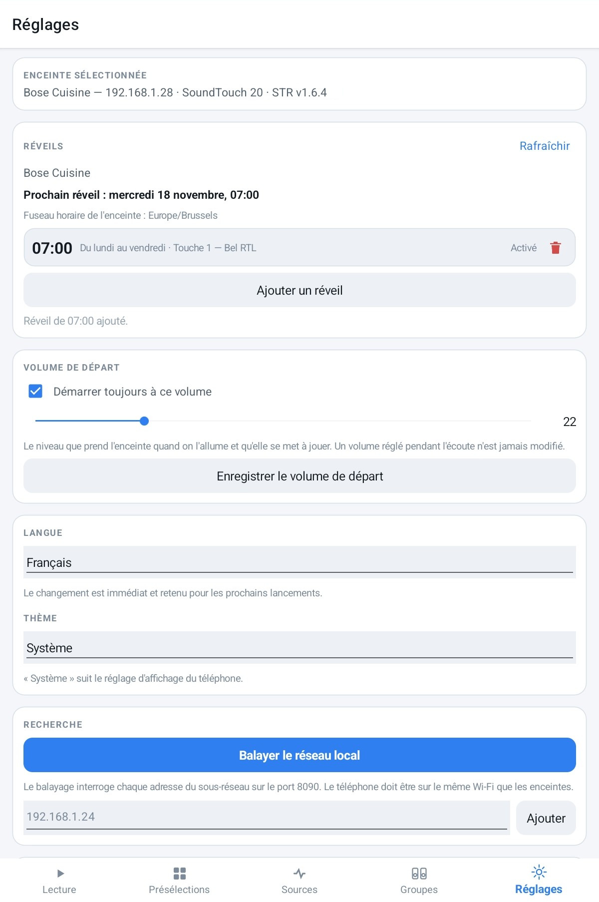

# SoundReborn Remote — Handbuch

Version 1.8.0 · Android 7 und neuer

> Sprachen: [Français](fr.md) · [English](en.md) · **Deutsch** · [Nederlands](nl.md) · [Español](es.md)

---

## Inhalt

1. [Was vorher da sein muss](#1-was-vorher-da-sein-muss)
2. [Installation](#2-installation)
3. [Erster Start](#3-erster-start)
4. [Der Reiter Wiedergabe](#4-der-reiter-wiedergabe)
5. [Der Reiter Presets](#5-der-reiter-presets)
6. [Der Reiter Quellen](#6-der-reiter-quellen)
7. [Der Reiter Gruppen](#7-der-reiter-gruppen)
8. [Der Reiter Einstellungen](#8-der-reiter-einstellungen)
9. [Gesten](#9-gesten)
10. [Was tun, wenn…](#10-was-tun-wenn)
11. [Bekannte Grenzen](#11-bekannte-grenzen)
12. [Hinweise](#12-hinweise)

---

## 1. Was vorher da sein muss

SoundReborn Remote steuert **Bose-SoundTouch-Lautsprecher** von einem Android-Telefon
oder -Tablet aus. Alles läuft im lokalen Netz: kein Konto, kein Onlinedienst, keine Daten,
die das Haus verlassen.

Vier Voraussetzungen:

- **Telefon und Lautsprecher im selben WLAN.** Vorsicht bei Gastnetzen und Routern, die
  Geräte voneinander abschotten — dann wird nichts gefunden.
- **Der STR-Agent auf den Lautsprechern.** Er ersetzt das, was die Bose-Cloud bis zu
  ihrer Abschaltung am 6. Mai 2026 geleistet hat. Ohne ihn funktioniert die App zwar
  weiter, aber beschränkt auf das, was allein die Firmware bietet: Lautstärke, Bass,
  bereits gespeicherte Tasten. Sendersuche, Tastenbelegung und zuverlässige Gruppen
  laufen alle über den Agenten.
  Installiert wird er mit dem STR-Werkzeug für PC oder Mac — <https://st-reborn.de>.
  **Diese App installiert ihn nicht**; sie weist lediglich auf Lautsprecher hin, denen er
  fehlt.
- **Ein STR-Agent 1.6.0 oder neuer, um Gruppen zu ändern.** Bei einem älteren Agenten
  weist die App darauf hin und lässt die Gruppen unverändert; alles andere funktioniert.
- **Android 7 oder neuer.**

---

## 2. Installation

Die App wird nicht über den Play Store verteilt. Sie steht auf der *Releases*-Seite des
Projekts: <https://github.com/ben240374/SoundRebornRemote/releases>

1. Lade die `.apk` auf das Telefon.
2. Öffne sie. Android fragt nach der Erlaubnis, aus einer unbekannten Quelle zu
   installieren — erteile sie der App, die heruntergeladen hat, meist dem Browser.
3. Installieren, dann öffnen.

Beim ersten Start wird keine besondere Berechtigung verlangt: Die App greift weder auf
Kontakte noch auf Standort noch auf Speicher zu.

---

## 3. Erster Start

Die App startet in der Sprache des Telefons, sofern sie sie kennt — Französisch,
Englisch, Deutsch, Niederländisch, Spanisch — sonst auf Englisch. Ändern lässt sich das
jederzeit.

Beim ersten Start ist kein Lautsprecher bekannt. Gehe zu **Einstellungen** und dann auf
**Lokales Netzwerk durchsuchen**.

Die Suche läuft in zwei Stufen. Zuerst bittet sie die Geräte, sich zu melden (mDNS) — der
schnelle Weg, zwei bis drei Sekunden. Antwortet niemand, fragt sie alle 254 Adressen des
Subnetzes einzeln auf Port 8090 ab: einige Sekunden länger, funktioniert aber auch dort,
wo Multicast gefiltert wird.

Gefundene Lautsprecher erscheinen unter **BEKANNTE LAUTSPRECHER**. Tippe bei dem
gewünschten auf **Verwenden**. Er wird gemerkt: Beim nächsten Start verbindet sich die
App von selbst wieder.

Findet der Suchlauf nichts, du kennst aber die IP-Adresse des Lautsprechers, trage sie in
das vorgesehene Feld ein und tippe auf **Hinzufügen**.

---

## 4. Der Reiter Wiedergabe

Der Hauptbildschirm, den man öffnet, um schnell etwas zu tun.

### Die Wahl des Lautsprechers

Oben je eine Karte pro bekanntem Lautsprecher, mit Modell und Version des STR-Agenten.
Die blau umrandete Karte ist der gesteuerte Lautsprecher; tippe auf eine andere Karte, um
zu wechseln, ohne den Umweg über die Einstellungen.

Der kleine Punkt rechts zeigt die Verbindung: **direkt** heißt, der Lautsprecher meldet
Änderungen in Echtzeit, **Abfrage**, dass die App sie in Abständen neu liest. Im
Abfragemodus erscheint eine Änderung von einer anderen Fernbedienung erst nach ein, zwei
Sekunden.

### Gerade läuft

Cover, Titel und Quelle des Laufenden. Bei einem Radiosender dessen Logo und Name, bei
Spotify das Albumcover.

### Steuerung

Vier Tasten: Stopp, zurück, Wiedergabe/Pause, vor. Je nach Quelle bleiben manche ohne
Wirkung — ein Livestream lässt sich nicht zurückspulen.

Der grüne Balken **Standby** schaltet den Lautsprecher aus; ist er aus, heißt er
**Einschalten**.

Unter dem Balken schickt **Sleeptimer** den Lautsprecher nach 15 bis 120 Minuten in den
Standby. Solange er läuft, zeigt der Link die Restzeit; tippe darauf, um die Dauer zu
ändern oder abzubrechen. In einer Gruppe fragt die App, ob die ganze Gruppe oder nur der
ausgewählte Lautsprecher ausgehen soll. Der Timer lebt im STR-Agenten des Lautsprechers:
Er läuft weiter, wenn du die App schließt, ein Neustart des Lautsprechers bricht ihn aber
ab. Der Link erscheint nur, wenn der Agent den Timer kennt.

### Lautstärke

Stumm, Angleichen, Minus, Regler, Plus. Der Prozentwert steht rechts.

Gehört der Lautsprecher zu einer Gruppe, wird dieser Regler zur **Lautstärke der ganzen
Gruppe**: Er verschiebt alle Lautsprecher um denselben Betrag und erhält damit das
Verhältnis, das du eingestellt hast. Küche auf 60, Wohnzimmer auf 30 — die Gruppe um 10
angehoben ergibt 70 und 40, nicht 70 und 35.

Die Taste **=** zwischen Stumm und Minus macht das Gegenteil: Sie setzt *alle*
Lautsprecher der Gruppe auf den angezeigten Wert. Gruppe auf 25, alle auf 25. Sie
erscheint nur, solange eine Gruppe aktiv ist — allein gibt es nichts anzugleichen.

Unter dem Regler führt **Pro Lautsprecher** jedes Mitglied der Gruppe mit eigenem Regler
und eigenen Tasten − und + auf, sodass du die Küche leiser stellen kannst, ohne das
Wohnzimmer anzurühren. Ein ausgeschalteter Lautsprecher wird blass dargestellt und
reagiert nicht: Ein Befehl an ihn ließe die App nur vergeblich warten.

### Bass und Presets

Der Bass reicht je nach Modell von -10 bis +10. **Eine Höhenregelung gibt es nicht**: Die
API des Lautsprechers bietet keine — das ist kein Versäumnis der App.

Die sechs Presets stehen hier noch einmal, um einen Reiterwechsel zu sparen. Die grün
umrandete Kachel ist die laufende.

Wenn der STR-Agent die zweite Reihe unterstützt, erscheinen über den Kacheln zwei
Schaltflächen, **Einmal** und **Zweimal**: Die zweite zeigt die sechs Sender, die der
Lautsprecher startet, wenn eine Taste zweimal gedrückt wird. Die Wahl gilt für beide
Reiter.

**Laufendes auf eine Taste legen**, unter den Kacheln, speichert das, was der
Lautsprecher gerade spielt — Sender, Album oder Titel aus der Bibliothek — auf der Taste
deiner Wahl. Spotify, AUX und Bluetooth lassen sich so nicht speichern.

### Gruppieren mit

Ein Plättchen je Lautsprecher, außer dem, der die Befehle erhält. Tippe darauf, um den
Lautsprecher der Gruppe hinzuzufügen; ein Haken und ein grüner Rand erscheinen. Noch
einmal tippen nimmt ihn wieder heraus.

Das Gruppieren dauert einige Sekunden: Währenddessen zeigt der Block *Gruppierung mit … läuft…*, danach das Ergebnis — oder den Fehler, in Rot.

**Der Master wird ermittelt, nicht angenommen.** In einer Gruppe gibt ein Lautsprecher
wieder, die anderen folgen ihm. Wählst du einen folgenden Lautsprecher, sagt die App es
— *Gruppiert mit …*, in Bernstein — und schickt Transport, Presets und
Lautstärke an den Master, denn er ist es, der wiedergibt. Einen Lautsprecher zu wählen
unterbricht also nie, was gerade läuft. Standby und Sleeptimer sind die Ausnahme: Sie
wirken auf den ausgewählten Lautsprecher.

Auf einem folgenden Lautsprecher ist das angehakte Plättchen dieser Lautsprecher selbst:
Tippen verlässt die Gruppe. Erweitert wird die Gruppe vom Master aus, denn er stellt sie
zusammen.

**Einen Lautsprecher auszuschalten nimmt ihn zuerst aus der Gruppe** und löst die Gruppe
auf, wenn es der letzte war. Beim Wiedereinschalten steht er allein da, gibt wieder, was
er wiederzugeben hat, und kann erneut gruppiert werden.

Der Link **Aktualisieren** unten liest alles neu: laufender Titel, Cover, Lautstärke,
Zustand der Gruppe.

---

## 5. Der Reiter Presets

### Die sechs Tasten

Dieselben wie die physischen Tasten am Lautsprecher. Jede Kachel zeigt Senderlogo und
Bitrate. Tippen startet die Wiedergabe; der grüne Rahmen markiert die laufende.

Logos werden heruntergeladen und danach lokal behalten. Fehlt eines, veröffentlicht der
Sender kein brauchbares Bild, oder sein Server antwortet nicht.

### Einmal, zweimal

Mit einem aktuellen STR-Agenten (ab v1.6) trägt jede Taste des Lautsprechers zwei
Sender: Ein Druck startet den ersten, zwei schnelle Drücke den zweiten. Die
Schaltflächen **Einmal** und **Zweimal** wählen die angezeigte Reihe; die Kacheln
behalten ihre Tastennummer, ① bis ⑥.

Die zweite Reihe existiert nur im Agenten: Auf einem Lautsprecher ohne Agent oder mit
einem älteren erscheinen die Schaltflächen nicht.

Eine Taste, die nur in der zweiten Reihe einen Sender hat, erscheint unter **Einmal**
leer: Ein einfacher Druck am Lautsprecher startet dann den Sender der zweiten Reihe
(STR-Agent 1.6.3 und neuer).

### Tasten auf einen anderen Lautsprecher kopieren

Die Karte **Tasten kopieren** kopiert alle Tasten des gewählten Lautsprechers auf einen
anderen STR-Lautsprecher oder auf alle. Tippe auf **Kopieren nach…**, wähle das Ziel und
bestätige. Jede hier belegte Taste ersetzt die des Ziels; die übrigen Tasten des Ziels
bleiben. Beide Reihen gehen an ein Ziel, das zwei hat. Gehört eine Spotify-Taste zur
Kopie, wird das Spotify-Konto dieses Lautsprechers an das Ziel übertragen: Die Rückfrage
weist darauf hin. Das Ergebnis erscheint pro Lautsprecher.

Das Kopieren braucht den STR-Agenten 1.6.5 oder neuer auf dem gewählten Lautsprecher.

### Einen Sender finden

Das Suchfeld fragt **radio-browser.info** ab, ein offenes, von Freiwilligen gepflegtes
Verzeichnis. Zwei Auswahllisten grenzen auf Land und Sprache ein, und **Top-Liste** zeigt
die meistgehörten Sender, ohne etwas einzutippen.

Das Kästchen **Nur Bose-kompatible** ist standardmäßig gesetzt und sollte es bleiben: Es
filtert die Formate heraus, die SoundTouch-Lautsprecher nicht decodieren (Ogg, Opus,
FLAC) und die zu Stille ohne Fehlermeldung führen würden.

Tippe auf ein Ergebnis, dann öffnet sich ein Auswahlblatt mit

- **Anhören** — startet den Sender sofort, ohne etwas zu speichern;
- **① Dieser Taste zuweisen**, wenn die Taste frei ist, oder **① Bel RTL ersetzen**, wenn
  sie belegt ist — der Name des bereits gespeicherten Senders wird angezeigt, damit du
  keinen überschreibst, an dem dir lag.

**Das Zuweisen setzt den STR-Agenten voraus.** Ohne ihn ist nur sofortiges Anhören
möglich; gespeichert wird dann durch Gedrückthalten der Taste am Lautsprecher selbst oder
über die STR-Desktop-App.

Mit der zweiten Reihe bietet das Menü zwölf Tasten an: **①** bis **⑥**, dann **①×2**
bis **⑥×2**. Ein Sender liegt immer nur auf einer Taste: Ist er schon woanders
gespeichert, lehnt der Agent ab, und die App nennt die Taste, auf der er liegt.

---

## 6. Der Reiter Quellen

**Bluetooth**, **AUX** und **Standby** oben: drei direkte Verknüpfungen.

**Spotify** wird nicht aus dieser App gesteuert. Öffne Spotify auf dem Telefon und wähle
den Lautsprecher in der Geräteauswahl (Spotify Connect): Er erscheint dort, sobald der
STR-Agent läuft.

**Quellen des Lautsprechers** listet auf, was der Lautsprecher meldet, mit Zustand:
`READY` heißt verfügbar, `UNAVAILABLE`, dass die Quelle zwar existiert, aber nicht nutzbar
ist — typischerweise ein Streamingdienst, dessen Konto seit der Cloud-Abschaltung nicht
mehr erreichbar ist.

**Einen Stream abspielen** nimmt die Adresse eines direkten Audiostreams entgegen — eine
`.mp3` oder eine `.m3u8` — und startet ihn auf dem Lautsprecher. Nützlich für ein
Webradio, das im Verzeichnis fehlt. Dafür ist der STR-Agent nötig.

**Aufnehmen** speichert einen Ausschnitt des Internetradios, das der Lautsprecher
spielt, auf dem Telefon – zum erneuten Anhören oder zum Versenden (WhatsApp, E-Mail…).
Tippe auf **Aufnehmen**: Die Aufnahme endet, wenn du **Stoppen** tippst, oder von selbst
nach 5 Minuten. Sie läuft bei ausgeschaltetem Bildschirm weiter: Eine Benachrichtigung
„Aufnahme läuft“ zeigt den Zähler und eine Taste **Stoppen**. Bei der ersten Aufnahme fragt
Android 13 und neuer, ob Benachrichtigungen erlaubt sind; lehnst du ab, wird trotzdem
aufgenommen, nur ohne Benachrichtigung.

Aufgenommen werden nur Internetradios, deren Stream erreichbar ist: STR-Speicherplätze,
im Verzeichnis gefundene Sender, von Hand gestartete Streams. Spotify, Deezer, Bluetooth
und AUX laufen nicht über das Telefon und lassen sich nicht aufnehmen, HLS-Streams
(`.m3u8`) ebenfalls nicht. Das Telefon öffnet den Stream des Senders parallel zum
Lautsprecher: Die Wiedergabe wird nicht gestört, aber die Aufnahme verbraucht Daten, etwa
1 MB pro Minute.

Die Liste behält die letzten 10 Aufnahmen mit Sender, Datum und Dauer. ▶ spielt sie auf dem
Telefon ab, ⤴ öffnet das Teilen-Menü von Android, der Papierkorb löscht nach Rückfrage. Bei
10 Aufnahmen verweigert die App eine neue: Lösche zuerst die, die du nicht mehr brauchst.
Die Aufnahmen bleiben in der App und verschwinden, wenn du sie deinstallierst. Die Liste bleibt verfügbar, auch wenn kein Lautsprecher antwortet: Nur das Aufnehmen ist dann nicht möglich.

**Zuletzt gehört** zeigt den vom Agenten geführten Verlauf: Tippe auf eine Zeile, um
erneut zu starten.

Ein Album oder Ordner aus der Bibliothek wird vollständig erneut abgespielt, nicht nur
der erste Titel. Ist der Medienserver ausgeschaltet, sagt die App das, statt eine
Wiedergabe anzukündigen, die nie startet.

---

## 7. Der Reiter Gruppen

**Master-Lautsprecher** nennt den, der tatsächlich wiedergibt — von den Lautsprechern
selbst gelesen, nicht als der angenommen, den du ausgewählt hast.

**Zu gruppierende Lautsprecher**: Hake die an, die folgen sollen, dann **Gruppieren**.
**Auflösen** löst die ganze Gruppe auf.

Ein Lautsprecher gehört immer nur zu einer Gruppe, und der Master stellt sie zusammen.
Folgt der ausgewählte Lautsprecher einem anderen, ist **Gruppieren** ausgegraut und eine
Meldung verweist auf den Master.

Die Option **Dauerhafte Gruppe** bittet den Agenten, die Gruppe bei der nächsten
Wiedergabe neu zu bilden, statt sie zerfallen zu lassen, wenn die Musik endet. Die App
liest dieses Kennzeichen jetzt zurück, bevor sie eine bestehende Gruppe erweitert, und
gibt es unverändert weiter: Einen Lautsprecher hinzuzufügen macht aus einer dauerhaften
Gruppe keine gewöhnliche mehr.

**Gruppenlautstärke** wirkt auf alle Lautsprecher zugleich und verschiebt die Werte,
ohne die Abstände anzutasten. Küche auf 60, Wohnzimmer auf 30 — die Gruppe um 10
angehoben ergibt 70 und 40, nicht 70 und 35. Unter dem Regler hat jeder Lautsprecher der
Gruppe seinen eigenen. **Auf die ganze Gruppe anwenden** setzt alle auf denselben Wert,
genau wie die Taste **=** im Reiter Wiedergabe. Dieser Block erscheint nur, wenn eine Gruppe besteht.

Eine permanente Gruppe bleibt so, wie du sie zusammengestellt hast. Einen ihrer
Lautsprecher in den Standby zu schicken nimmt ihn aus der laufenden Gruppe, ohne ihn aus
der gespeicherten Gruppe zu entfernen: Bei der nächsten Wiedergabe ist er wieder dabei.
Und wartet eine permanente Gruppe auf ihre nächste Wiedergabe, weist die App darauf hin
und fragt nach, bevor sie an ihrer Stelle eine andere bildet.

Spielt keine Gruppe, ist eine normale Gruppe gespeichert und du setzt das Häkchen bei
**Dauerhafte Gruppe**, fragt die App ebenfalls nach: Eine dauerhafte Gruppe, die der Agent
dahinter zurückhält, würde ersetzt.

---

## 8. Der Reiter Einstellungen

**Ausgewählter Lautsprecher**: Name, Adresse und Modell. Das ist der Lautsprecher, den
du gewählt hast — nicht zwingend der, der die Befehle erhält. Folgt er einer Gruppe,
sagt eine bernsteinfarbene Zeile, wohin die Befehle tatsächlich gehen und warum.

**Wecker**: die des ausgewählten Lautsprechers — ein Wecker klingelt nur auf dem
Lautsprecher, auf dem er gespeichert ist, auch in einer Gruppe. Jeder Wecker spielt eine
Taste (1 bis 6, oder 1 bis 6 zweimal gedrückt) zur gewählten Zeit an den gewählten Tagen.
Dazu stellst du seine Lautstärke ein (oder behältst die des Lautsprechers), das
automatische Ausschalten und die Schlummerdauer. Die Karte zeigt den nächsten Wecker so,
wie ihn der Lautsprecher plant, und warnt, wenn seine Uhr noch nicht gestellt ist. Ist die
Zeitzone des Lautsprechers leer (UTC), wird die des Telefons mit dem nächsten Wecker
gespeichert. Anderswo geänderte Wecker — STR-Telefonseite, Desktop-App — werden nicht
überschrieben: Die App speichert nur, was du geändert hast. Erfordert den STR-Agenten. Die Uhrzeit wird auf dem Ziffernblatt des Telefons eingestellt. Der Papierkorb einer Zeile löscht den Wecker nach Bestätigung.

**Startlautstärke**: die Lautstärke, die der Lautsprecher beim Einschalten annimmt, sobald
er spielt. Häkchen setzen, Lautstärke wählen, dann **Startlautstärke speichern**. Eine
während des Hörens eingestellte Lautstärke wird nie geändert.

**Sprache**: Deutsch, Französisch, Englisch, Niederländisch, Spanisch. Die Umstellung
gilt sofort, ohne Neustart, und wird gemerkt.

**Thema**: System, Hell oder Dunkel. „System" folgt der Anzeigeeinstellung des Telefons,
einschließlich der automatischen Umschaltung am Abend.

**Suche**: der Netzwerk-Scan und die manuelle Eingabe einer IP-Adresse. Die Suche fragt
zuerst mDNS und durchsucht das Subnetz nur, wenn dabei nichts gefunden wird. Der
Durchlauf ist auf private Adressbereiche beschränkt und erreicht damit nie ein Mobilnetz
oder einen VPN-Tunnel.

**Bekannte Lautsprecher**: die gemerkte Liste. **Verwenden** wechselt zu einem, **✕**
vergisst ihn. Ein Lautsprecher mit dem Hinweis **„Kein STR — bereit zur Installation"**
antwortet einwandfrei, hat aber keinen Agenten; weiter unten erscheint dann ein
erklärender Block mit einem Link zur Seite des STR-Projekts.

Ein Lautsprecher, dessen Agent älter als Version 1.6.0 ist, zeigt einen ähnlichen Block,
**STR-Agent zu alt**, und seine Karte im Tab Wiedergabe trägt den Hinweis „zu alt".

**Diagnose**: *Lautsprecher abfragen* betrifft den **ausgewählten** Lautsprecher — Name,
Modell, Geräte-ID, Firmware-Version, den Agenten mit Port und live auf 17008 und 8888
gelesener Version, den Zustand der Benachrichtigungen, den Bassbereich, die Liste der
erkannten API-Endpunkte und das, was jeder bekannte Lautsprecher über die aktuelle Zone
sagt. Das sind die Angaben, die in eine Fehlermeldung gehören. *Logo-Cache leeren*
erzwingt das erneute Laden der Senderbilder.

**Über**: die Version, der Dank an das STR-Projekt mit einem Link zu dessen Seite in der
gewählten Sprache, und die rechtlichen Hinweise.

---

## 9. Gesten

**Waagerechtes Wischen** wechselt zum nächsten oder vorherigen Reiter: Wiedergabe →
Presets → Quellen → Gruppen → Einstellungen. Die Geste muss zügig sein; ein langsames
Ziehen wird nicht als Reiterwechsel gelesen.

Ein Wischen, das **auf einem Regler** beginnt, gehört dem Regler: Das ist gewollt, sonst
ließe sich die Lautstärke nicht mehr einstellen. Beginne die Geste auf einer freien
Fläche.

---

## 10. Was tun, wenn…

**Der Suchlauf findet keinen Lautsprecher.**
Prüfe, ob das Telefon im selben WLAN ist wie die Lautsprecher und nicht im Gastnetz oder
im Mobilfunk. Manche Router schotten Geräte voneinander ab — die Einstellung heißt
meist *AP-Isolation* oder *Client-Modus*. Kennst du die IP-Adresse, trage sie in den
Einstellungen von Hand ein.

**Der Lautsprecher erscheint, reagiert aber nicht.**
Wahrscheinlich ist er im Tiefschlaf. Wecke ihn mit der Ein-/Aus-Schaltfläche im Reiter
Wiedergabe oder drücke eine Taste am Gerät.

**Ein Preset bewirkt nichts.**
Eine leere Taste hat nichts zu starten. Prüfe außerdem, ob der Lautsprecher aus ist.

**Es werden keine Senderlogos angezeigt.**
Leere den Logo-Cache in der Diagnose. Bleibt es bei einem bestimmten Sender, liegt es an
dessen eigenem Bildserver.

**Bei einem Lautsprecher fehlt die Agentenversion.**
Entweder ist der Agent dort nicht installiert, oder er ist zu alt, um seine Versionsnummer
zu veröffentlichen. Starte den Suchlauf erneut.

**Die Gruppe bildet sich nicht.**
Beide Lautsprecher müssen eingeschaltet und erreichbar sein. Fehlt einem der STR-Agent,
läuft das Gruppieren über die Firmware — weniger zuverlässig und mitunter ohne Meldung
abgelehnt.

**Die App ist in der falschen Sprache.**
Einstellungen → Sprache. Die Wahl hat Vorrang vor der Sprache des Telefons.

**Die Taste Aufnehmen ist ausgegraut.**
Die Meldung unter dem Titel nennt den Grund: Es läuft nichts, die Quelle ist kein
Internetradio, oder die Stream-Adresse dieses Senders ist unbekannt. Starte den Sender
erneut über einen Speicherplatz oder das Verzeichnis und öffne dann den Reiter Quellen neu.

---

## 11. Bekannte Grenzen

- **Keine Höhenregelung.** Die API des Lautsprechers bietet keine.
- **Die App installiert den STR-Agenten nicht.** Das verlangt Systemzugriff auf den
  Lautsprecher und einen Neustart; dafür ist das STR-Werkzeug für PC oder Mac da.
- **Spotify wird aus Spotify gesteuert**, über Spotify Connect.
- **Kein Durchsuchen einer DLNA-Bibliothek**, bislang.
- **Nur Android.** Eine iOS-Fassung gibt es nicht.
- **Zweite Reihe, Sleeptimer und „Laufendes auf eine Taste legen“ erfordern einen
  aktuellen STR-Agenten.** Mit einem älteren Agenten erscheinen diese Befehle nicht oder
  werden abgelehnt.
- **Stereopaare.** Die App bildet und löst keine Stereopaare. Ein Paar kann keine Gruppe
  leiten; mit einem STR-Agenten 1.6.3 oder neuer kann es einer Gruppe beitreten, die auf
  einem anderen Lautsprecher gestartet wurde.
- **Aufnahme: nur Internetradios**, höchstens 5 Minuten pro Aufnahme, 10 Aufnahmen
  werden behalten.
- **Tasten kopieren: STR-Agent 1.6.5 oder neuer** auf dem Quell-Lautsprecher.
- **Die Spotify-Tasten „Daumen hoch“ und „Daumen runter“** funktionieren nur auf der
  Fernbedienung des Lautsprechers (STR-Agent 1.8.0): Der Agent bietet sie Apps nicht an.

---

## 12. Hinweise

SoundReborn Remote ist ein privates Projekt unter MIT-Lizenz.

Es wird **weder von der Bose Corporation hergestellt noch von ihr unterstützt**. „Bose"
und „SoundTouch" sind Marken der Bose Corporation und werden hier nur genannt, um die
Kompatibilität anzugeben.

Es ist **unabhängig vom STR-Projekt**: von ihm weder entwickelt noch gepflegt noch
unterstützt. Probleme mit dieser App bitte
[im eigenen Repository](https://github.com/ben240374/SoundRebornRemote/issues) melden,
nicht beim STR-Projekt.

Der Agent **STR (SoundTouch Reborn)** stammt von Jens Roggenfelder
([JRpersonal](https://github.com/JRpersonal/streborn)) — <https://st-reborn.de>. Ohne ihn
hätte diese App nichts zu steuern.

Das Senderverzeichnis stellt [radio-browser.info](https://www.radio-browser.info) bereit.

Der Code wurde mit Claude (Anthropic) geschrieben.
