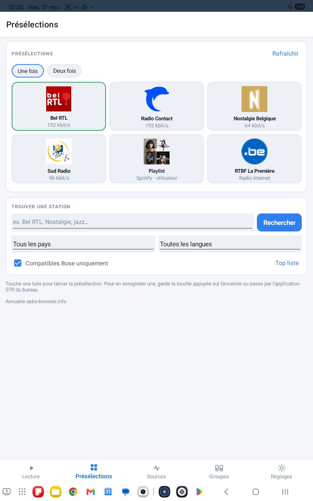

# SoundReborn Remote — Manual de uso

Versión 1.9.2 · Android 7 y posteriores

> Idiomas: [Français](fr.md) · [English](en.md) · [Deutsch](de.md) · [Nederlands](nl.md) · **Español** · [Italiano](it.md)

---

## Índice

1. [Lo que hace falta antes de empezar](#1-lo-que-hace-falta-antes-de-empezar)
2. [Instalación](#2-instalación)
3. [Primer arranque](#3-primer-arranque)
4. [La pestaña Reproducción](#4-la-pestaña-reproducción)
5. [La pestaña Presintonías](#5-la-pestaña-presintonías)
6. [La pestaña Fuentes](#6-la-pestaña-fuentes)
7. [La pestaña Grupos](#7-la-pestaña-grupos)
8. [La pestaña Ajustes](#8-la-pestaña-ajustes)
9. [Gestos](#9-gestos)
10. [Qué hacer si…](#10-qué-hacer-si)
11. [Límites conocidos](#11-límites-conocidos)
12. [Avisos](#12-avisos)

---

## 1. Lo que hace falta antes de empezar

SoundReborn Remote controla altavoces **Bose SoundTouch** desde un teléfono o una tableta
Android. Todo ocurre en tu red local: sin cuenta, sin servicio en línea, sin datos que
salgan de casa.

Cuatro condiciones:

- **El teléfono y los altavoces en la misma wifi.** Cuidado con las redes de invitados y
  con los routers que aíslan los aparatos entre sí: en ese caso no se encontrará nada.
- **El agente STR instalado en los altavoces.** Es lo que sustituye a la nube de Bose
  desde que se apagó, el 6 de mayo de 2026. Sin él la aplicación sigue funcionando, pero
  limitada a lo que expone el firmware por sí solo: volumen, graves, teclas ya guardadas.
  La búsqueda de emisoras, la asignación de teclas y la agrupación fiable pasan todas por
  el agente.
  La instalación se hace con la herramienta STR para PC o Mac — <https://st-reborn.de>.
  **Esta aplicación no lo instala**; solo señala los altavoces que no lo tienen.
- **Un agente STR 1.8.0 o posterior para cambiar grupos.** Con un agente más antiguo,
  la aplicación lo indica y no toca los grupos; todo lo demás funciona.
- **Android 7 o posterior.**

---

## 2. Instalación

La aplicación no se distribuye por Play Store. Se descarga en la página *Releases* del
proyecto: <https://github.com/ben240374/SoundRebornRemote/releases>

1. Descarga el archivo `.apk` en el teléfono.
2. Ábrelo. Android pedirá permiso para instalar desde un origen desconocido: concédeselo a
   la aplicación que ha descargado, normalmente el navegador.
3. Instala y abre.

Después, la aplicación avisa ella misma de las nuevas versiones y sabe instalarlas
(pestaña Ajustes, **Actualización**).

En el primer arranque no se pide ningún permiso especial: la aplicación no accede ni a los
contactos, ni a la ubicación, ni al almacenamiento.

---

## 3. Primer arranque

La aplicación se abre en el idioma del teléfono si lo conoce — francés, inglés, alemán,
neerlandés, español, italiano — y en inglés en caso contrario. Podrás cambiarlo cuando quieras.

En el primer arranque no hay ningún altavoz conocido. Ve a **Ajustes** y luego a
**Escanear la red local**.

La búsqueda se hace en dos tiempos. Primero pide a los aparatos que se anuncien (mDNS):
es la vía rápida, dos o tres segundos. Si nadie responde, consulta una por una las 254
direcciones de la subred en el puerto 8090, lo que tarda unos segundos más pero funciona
incluso donde se filtra el multicast.

Los altavoces encontrados aparecen bajo **ALTAVOCES CONOCIDOS**. Toca **Usar** en el que
quieras controlar. Queda memorizado: en el siguiente arranque la aplicación se reconecta
sola.

Si el escaneo no encuentra nada pero conoces la dirección IP del altavoz, escríbela en el
campo previsto y toca **Añadir**.

---

## 4. La pestaña Reproducción

La pantalla principal, la que se abre para actuar deprisa.

### Elegir el altavoz

Arriba, una tarjeta por altavoz conocido, con su modelo y la versión de su agente STR. La
tarjeta con borde azul es el altavoz que se controla; toca otra tarjeta para cambiar, sin
pasar por los ajustes.

El puntito de la derecha indica el enlace: **directo** significa que el altavoz envía sus
cambios en tiempo real, **sondeo** que la aplicación los vuelve a leer a intervalos. En
modo sondeo, un cambio hecho desde otro mando tarda uno o dos segundos en aparecer.

### En este momento

La carátula, el título y la fuente de lo que suena. Para una emisora, su logotipo y su
nombre; para Spotify, la portada del álbum.

Cuando suena Spotify y el agente STR es la versión 1.8.1 o posterior, aparecen dos botones
bajo el título: **Me gusta** añade la canción actual a Tus me gusta, **No me gusta** la
quita, como las teclas de pulgar del mando. La canción va a la cuenta de Spotify con la que
el **altavoz** ha iniciado sesión, que no es necesariamente la de tu teléfono. Un altavoz
con pantalla muestra «LIKED» o «REMOVED».

Durante una tecla de Spotify (una presintonía que reproduce una lista de Spotify), el altavoz
solo conoce el nombre de la lista. Con el agente STR 1.8.2 o posterior, la aplicación muestra
en su lugar la canción, el artista y la carátula, con «Spotify · lista» como fuente; la
canción se vuelve a leer cada cinco segundos aproximadamente.

Con una radio por internet, la aplicación muestra también la canción que anuncia la
emisora, como la pantalla del altavoz: el título en grande, el artista debajo y «emisora ·
Radio por Internet» como fuente. Una emisora que no envía nada, o solo su nombre, conserva
la presentación habitual; un texto sin artista (un programa, un anuncio) se muestra tal
cual. La canción se vuelve a leer cada cinco segundos aproximadamente.

### Mandos

Cuatro teclas: parar, anterior, reproducir/pausar, siguiente. Según la fuente, algunas no
tienen efecto: una radio en directo no se rebobina.

La banda verde **Reposo** apaga el altavoz; una vez apagado, pasa a leerse **Encender**.

Bajo la banda, **Temporizador de apagado** pone el altavoz en reposo tras 15 a 120
minutos. Mientras corre, el enlace muestra el tiempo restante; tócalo para cambiar la
duración o cancelar. En un grupo, la aplicación pregunta si debe apagarse todo el grupo o
solo el altavoz seleccionado. El temporizador vive en el agente STR del altavoz: sigue
corriendo si cierras la aplicación, pero un reinicio del altavoz lo cancela. El enlace
solo aparece si el agente conoce el temporizador.

### Volumen

Silencio, igualar, menos, control deslizante, más. El porcentaje aparece a la derecha.

Cuando el altavoz forma parte de un grupo, este control pasa a ser **el volumen de todo
el grupo**: moverlo desplaza todos los altavoces en la misma medida, lo que conserva el
equilibrio que has ajustado entre ellos. Cocina a 60 y salón a 30 — subir el grupo 10 da
70 y 40, no 70 y 35.

La tecla **=**, entre silencio y menos, hace lo contrario: pone *todos* los altavoces
del grupo en el valor mostrado. Grupo a 25, todos a 25. Solo aparece mientras hay un
grupo activo — en solitario, un altavoz no tiene nada que igualar.

Debajo del control, **Por altavoz** muestra una línea por miembro del grupo, con su
propio control y sus teclas − y +, para bajar la cocina sin tocar el salón. Un altavoz
apagado aparece atenuado y no responde: enviarle una orden solo haría esperar a la
aplicación para nada.

### Graves y presintonías

Los graves van de -10 a +10 según el modelo. **No hay control de agudos**: la API del
altavoz no ofrece ninguno; no es un olvido de la aplicación.

Las seis presintonías se repiten aquí para ahorrar un cambio de pestaña. La tarjeta con
borde verde es la que suena.

Cuando el agente STR admite la segunda fila, aparecen sobre las tarjetas dos botones,
**Una vez** y **Dos veces**: el segundo muestra las seis emisoras que el altavoz inicia
al pulsar una tecla dos veces. La elección vale para las dos pestañas. Cada tarjeta muestra arriba el nombre de su tecla («Tecla 1» a «Tecla 6», en las dos
filas), y el botón **Dos veces** lleva un pequeño número: cuántas teclas de la segunda fila
tienen una emisora.

A la derecha de los botones, **Local** sustituye las tarjetas por tus presintonías
locales, guardadas en el teléfono (ver la pestaña Presintonías); **Una vez** devuelve las
teclas del altavoz. En una pantalla estrecha, **Local** y **★ STR** pasan a una segunda
línea, debajo de **Una vez** y **Dos veces**.

El botón **Una vez** también lleva un pequeño número: cuántas teclas de la primera fila
tienen una emisora.

**Guardar lo que suena en una tecla**, bajo las tarjetas, guarda en la tecla que elijas
lo que el altavoz reproduce en este momento — emisora, álbum o pista de la biblioteca.
Spotify, AUX y Bluetooth no se pueden guardar así.

### Mensaje de voz

La tarjeta **Mensaje de voz** hace hablar al altavoz y luego le deja volver a lo que sonaba.

- **Tu voz**: mantén pulsado el botón redondo del micrófono mientras hablas y suéltalo
  para enviar (1 minuto como máximo). El botón se vuelve rojo durante la grabación. El
  teléfono guarda el mensaje hasta que el altavoz viene a buscarlo y luego lo borra.
- **Un texto**: escríbelo bajo el botón y luego **Leer**. El altavoz lo lee con la voz de
  Google, en el idioma de la aplicación; necesita acceso a internet, y el texto pasa por
  Google.
- **Guardar** añade el texto escrito a la lista de textos guardados (diez como máximo).
  Pulsa un texto guardado para que se lea; **✎** lo edita, **✕** lo elimina tras
  confirmar.

Una breve vibración indica que el micrófono está grabando: habla a partir de ahí. La
aplicación añade un poco de silencio antes y después del mensaje, para que el altavoz, que
abre su amplificador con retraso, no se trague el principio. Un texto tiene 200 caracteres
como máximo.

El control **Volumen de los anuncios** ajusta el volumen del mensaje, voz y texto: todo a la
izquierda, el altavoz conserva su volumen; si no, pasa a ese volumen durante el mensaje y
luego vuelve al anterior. El micrófono del teléfono no se puede ajustar: para un mensaje más
fuerte, sube este control.

El mensaje va al altavoz que recibe las órdenes. Todavía no suena en todos los altavoces de
un grupo: está previsto en el agente STR. La primera vez, Android pide acceso al micrófono.
La tarjeta solo aparece con el agente STR.

### Agrupar con

Una pastilla por altavoz, salvo el que recibe las órdenes. Tócala para añadir ese
altavoz al grupo; aparecen una marca y un contorno verde. Tócala de nuevo para sacarlo.

Agrupar tarda unos segundos: mientras tanto el bloque muestra *Agrupando con …*, y después el resultado — o el error, en rojo.

**El maestro se busca, no se supone.** En un grupo, un altavoz reproduce y los demás lo
siguen. Si seleccionas un altavoz que sigue, la aplicación lo dice — *Agrupado con …*,
en ámbar — y envía el transporte, las presintonías y el volumen al maestro,
porque es él quien reproduce. Seleccionar un altavoz, por tanto, nunca interrumpe lo que
estás escuchando. El reposo y el temporizador son la excepción: actúan sobre el altavoz
seleccionado.

En un altavoz que sigue, la pastilla marcada es ese mismo altavoz: tocarla lo saca del
grupo. Ampliar el grupo se hace desde el maestro, ya que es él quien lo compone.

**Apagar un altavoz lo saca primero del grupo** y disuelve el grupo si era el último. Al
volver a encenderlo tienes un altavoz solo, reproduciendo lo que le toca, que puedes
agrupar de nuevo.

El enlace **Actualizar**, abajo, relee todo: título en curso, carátula, volumen y estado
del grupo.

Si el altavoz que añades está reproduciendo otra cosa, o está en pausa, la aplicación lo
dice antes de agrupar: «Salon está reproduciendo Radio Contact. Añadirlo al grupo detiene
eso para reproducir Bel RTL». No cambia nada hasta que tocas **Añadir**. Un altavoz en
reposo, o que ya reproduce lo mismo, se añade sin preguntar.

---

## 5. La pestaña Presintonías

### Las seis teclas

Las mismas que las teclas físicas del altavoz. Cada tarjeta muestra el logotipo de la
emisora y su tasa de bits. Tócala para empezar la reproducción; el borde verde marca la
que suena.

Los logotipos se descargan y luego se conservan localmente. Si falta alguno, la emisora no
publica una imagen utilizable o su servidor no responde.

### Una vez, dos veces

Con un agente STR reciente (v1.6 y posteriores), cada tecla del altavoz lleva dos
emisoras: una pulsación inicia la primera, dos pulsaciones rápidas la segunda. Los
botones **Una vez** y **Dos veces** eligen la fila mostrada; las tarjetas conservan su
número de tecla, de ① a ⑥.

La segunda fila solo existe en el agente: los botones no aparecen en un altavoz sin
agente, o con uno más antiguo.

Una tecla que solo tiene emisora en su segunda fila aparece vacía en **Una vez**: una
sola pulsación en el altavoz inicia entonces la emisora de la segunda fila (agente STR
1.6.3 y posteriores).

### Presintonías «Local»

El botón **Local**, a la derecha, muestra presintonías guardadas en el teléfono, además de
las teclas del altavoz y en número libre (100 como máximo). Pulsa una línea para iniciar
la radio en el altavoz elegido; **✎** la renombra, **✕** la quita tras confirmar. La línea
de la radio que suena aparece en verde.

Para añadir:

- **Añadir lo que suena** guarda la radio que el altavoz reproduce en este momento, con la
  dirección original del flujo y su logotipo;
- **Añadir una dirección** pide la dirección http o https del flujo y luego un nombre;
- en la búsqueda, pulsa una emisora y luego **Añadir a Local**.

Estas presintonías se quedan en este teléfono: las teclas del altavoz no las conocen, y
otro teléfono no las ve. Una lista de Spotify no se puede guardar ahí: el agente STR solo
inicia una lista desde una de sus teclas. Para conservarlas en una reinstalación, expórtalas desde la pestaña Ajustes (**Copia de los favoritos**).

### Renombrar y borrar una tecla

Cada tarjeta muestra arriba el nombre de su tecla. En una tecla guardada por el agente STR hay
dos pequeños botones a su lado: **✎** renombra la tecla y **✕** la borra, tras confirmar.
Renombrar solo cambia el nombre mostrado: la emisora, su imagen y la lista de una tecla de
Spotify se mantienen. Un nombre tiene como máximo 64 caracteres. El botón **Dos veces** indica
cuántas teclas de la segunda fila tienen una emisora.

Una tecla que solo conoce el firmware del altavoz, y una tecla vacía, no tienen esos botones:
el agente no tendría nada que renombrar ni borrar.

### Copiar las teclas a otro altavoz

La tarjeta **Copiar las teclas** copia todas las teclas del altavoz seleccionado a otro
altavoz STR, o a todos. Toca **Copiar a…**, elige el destino y confirma. Cada tecla
configurada aquí sustituye a la del destino; las demás teclas del destino se mantienen.
Las dos filas van a un destino que tiene dos. Cuando una tecla de Spotify forma parte de
la copia, la cuenta de Spotify de este altavoz se transmite al destino: la pregunta de
confirmación lo recuerda. El resultado se muestra por altavoz.

La copia requiere el agente STR 1.6.5 o posterior en el altavoz seleccionado.

### Favoritos STR

Con un agente STR reciente, el botón **★ STR**, a la derecha de **Local** (pestañas
Reproducción y Presintonías), muestra en lugar de las teclas las emisoras con estrella de
la aplicación STR del ordenador. Son las mismas en todos los altavoces STR: un favorito
añadido o quitado aquí también lo es, unos segundos después, en los demás altavoces y en
el ordenador. **Una vez** o **Dos veces** devuelve las teclas.

- Toca un favorito para ponerlo en el altavoz seleccionado.
- **⋯** ofrece **Poner en una tecla…**, **Añadir a Local** y **Quitar de favoritos STR**
  (tras confirmar).
- **★ Añadir lo que suena** guarda la radio que suena en el altavoz; en la búsqueda,
  **⋯ Teclas, Local…** ofrece **★ Añadir a favoritos STR**.
- Una emisora de Pandora aparece en la lista, pero se pone desde la aplicación STR.

### Encontrar una emisora

El campo de búsqueda consulta **radio-browser.info**, un directorio abierto mantenido por
voluntarios. La búsqueda sigue la de la aplicación de escritorio de STR:

- **País** (todos por orden alfabético, territorios de ultramar incluidos: Martinica,
  Reunión, Guadalupe…) e **Idioma** acotan la búsqueda; **Ordenar** clasifica por popularidad (votos),
  escuchas, tendencia, nombre o tasa de bits. Cambiar una de estas opciones repite la
  última búsqueda.
- Las **etiquetas de género** (Todos, Pop, Rock, Éxitos, Jazz, Años 80…) filtran por
  género; las dos primeras dependen del país (Reggaeton y Salsa para España). **Más
  géneros** añade los géneros más frecuentes del directorio. Sin escribir nada, una
  etiqueta recorre el directorio, como la Top lista.
- **Top lista** muestra las emisoras más votadas, con estos filtros.
- Una búsqueda de varias palabras también busca esas palabras en los géneros («rock
  belge»), y encuentra un nombre escrito con otra puntuación («Mi Soul» encuentra
  «Mi-Soul»).
- Una dirección de flujo pegada en el campo (http://… o https://…) encuentra la emisora del
  directorio que la emite; si es desconocida aparece como **Dirección pegada**, que puedes
  escuchar o guardar como cualquier otra.
- **Ver más**, bajo los resultados, añade la página siguiente.

**Solo emisoras activas** (marcada por defecto) descarta las emisoras que el directorio
encontró caídas en su último control. Una emisora recién añadida, aún no controlada, sigue
visible. Si un nombre solo encuentra emisoras marcadas como caídas, se muestran igualmente,
con un aviso: el directorio controla desde el extranjero, y una emisora limitada a su país
parece muerta allí aunque en tu casa suene perfectamente.

**Solo compatibles con Bose** (marcada por defecto, mejor dejarla así) descarta los formatos
que los altavoces SoundTouch no saben decodificar (Ogg, Opus, FLAC), que producirían
silencio sin mensaje de error. **Tasa de bits** oculta las emisoras por debajo de una tasa
elegida; las de tasa desconocida se quedan. Ambos filtros actúan sobre la lista recibida,
sin nueva búsqueda, y el número de emisoras ocultas aparece bajo el título de los
resultados.

**¿Falta una emisora?** El enlace bajo los resultados abre radio-browser.info, donde
cualquiera puede añadirla: aparecerá aquí, y para todos.

Toca un resultado: la línea se abre y ofrece tres opciones que no se pueden confundir.

- **📱 ▶ Escuchar en este teléfono** (o **esta tableta**): la emisora suena en el
  dispositivo, para oírla antes de enviarla al altavoz. El botón pasa a **📱 ■ Detener**;
  una barra encima de los resultados dice qué suena, con **■ Detener** y **🔊 Reproducir
  en …**. Una emisora a la vez; se detiene al salir de la pestaña o de la aplicación, y al
  enviar la emisora al altavoz. Sin Wi-Fi usa datos móviles (alrededor de 1 MB por minuto
  a 128 kbit/s). Una emisora que no suena en el dispositivo puede sonar igualmente en el
  altavoz: el agente STR convierte formatos que el reproductor de Android no lee.
- **🔊 Reproducir en Cocina**: con el nombre completo del altavoz elegido; la emisora
  arranca allí, sin guardar nada.
- **⋯ Teclas, Local…** abre una hoja de acciones con **Reproducir en Cocina**, **★ Añadir a favoritos STR** (agente reciente), **Añadir a
  Local**, y después **① Asignar a esta tecla** si la tecla está libre, o **① Sustituir
  Bel RTL** si está ocupada: se muestra el nombre de la emisora que ya hay, para que no
  sobrescribas una a la que tenías aprecio.

**La asignación exige el agente STR.** Sin él solo es posible la escucha inmediata; el
guardado se hace entonces manteniendo pulsada la tecla en el propio altavoz, o desde la
aplicación STR de escritorio.

Con la segunda fila, el menú ofrece doce teclas: de **①** a **⑥**, y luego de **①×2** a
**⑥×2**. Una emisora solo ocupa una tecla: si ya está guardada en otra, el agente lo
rechaza y la aplicación indica en qué tecla está.

---

## 6. La pestaña Fuentes

**Bluetooth**, **AUX** y **Reposo** arriba: tres atajos directos.

**Spotify** no se controla desde esta aplicación. Abre Spotify en el teléfono y elige el
altavoz en el selector de dispositivos (Spotify Connect): aparece allí en cuanto el agente
STR está en marcha.

**Fuentes del altavoz** enumera lo que el altavoz declara, con su estado: `READY` significa
disponible, `UNAVAILABLE` que la fuente existe pero no es utilizable — normalmente un
servicio de streaming cuya cuenta ya no es accesible desde el cierre de la nube.

**Reproducir un flujo** acepta la dirección de un flujo de audio directo — un `.mp3` o un
`.m3u8` — y lo lanza en el altavoz. Útil para una radio en línea ausente del directorio.
Requiere el agente STR.

**Grabar** guarda en el teléfono un fragmento de la radio por internet que reproduce el
altavoz, para volver a escucharlo o enviarlo (WhatsApp, correo…). Toca **Grabar**: la
grabación se detiene cuando tocas **Detener**, o sola a los 5 minutos. Continúa con la
pantalla apagada: una notificación «Grabando» muestra el contador y un botón **Detener**.
En la primera grabación, Android 13 y posteriores piden permitir las notificaciones; si te
niegas, se graba igualmente, sin notificación.

Solo se graban las radios por internet cuyo flujo es accesible: presintonías STR, emisoras
del directorio, flujos lanzados a mano. Spotify, Deezer, Bluetooth y AUX no pasan por el
teléfono y no se pueden grabar, como tampoco los flujos HLS (`.m3u8`). El teléfono abre el
flujo de la emisora en paralelo al altavoz: la escucha no se altera, pero la grabación
consume datos, alrededor de 1 MB por minuto.

La lista guarda las últimas 10 grabaciones, con la emisora, la fecha y la duración. ▶ las
reproduce en el teléfono, ⤴ abre el menú de compartir de Android, la papelera elimina tras
confirmar. Con 10 grabaciones, la aplicación no hace una nueva: elimina primero la que ya no
necesites. Las grabaciones se quedan en la aplicación y desaparecen si la desinstalas. La lista sigue disponible aunque ningún altavoz responda: solo la grabación es entonces imposible.

Mientras suena una grabación, aparecen debajo una barra y un contador: «01:23 / 04:50», la
posición y la duración. Desliza la barra para moverte por la grabación.

**Escuchado recientemente** recoge el historial que lleva el agente: toca una línea para
volver a empezar.

Un álbum o una carpeta de la biblioteca se reproduce de nuevo por completo, no solo su
primera pista. Si el servidor multimedia está apagado, la aplicación lo dice en lugar de
anunciar una reproducción que nunca empieza.

---

## 7. La pestaña Grupos

**Altavoz maestro** indica cuál reproduce de verdad — leído en los propios altavoces, no
supuesto como el que has seleccionado.

**Altavoces a agrupar**: marca los que deben seguir y pulsa **Agrupar**. **Disolver**
deshace todo el grupo.

Un altavoz pertenece a un solo grupo a la vez, y es el maestro quien lo compone. Si el
altavoz seleccionado sigue a otro, **Agrupar** aparece atenuado y un mensaje te remite
al maestro.

La opción **Grupo permanente** pide al agente que rehaga el grupo en la próxima
reproducción, en lugar de dejar que se deshaga cuando la música para. La aplicación
ahora relee este indicador antes de ampliar un grupo existente y lo devuelve sin
cambios: añadir un altavoz ya no degrada un grupo permanente a grupo corriente.

**Volumen del grupo** actúa sobre todos los altavoces a la vez, desplazando los
volúmenes sin tocar las diferencias. Cocina a 60 y salón a 30 — subir el grupo 10 da 70
y 40, no 70 y 35. Debajo de ese control, cada altavoz del grupo tiene el suyo.
**Aplicar a todo el grupo** pone a todos en el mismo valor, igual que la tecla **=** de
la pestaña Reproducción. Este bloque solo aparece cuando existe un grupo.

Un grupo permanente se queda como lo compusiste. Poner uno de sus altavoces en reposo
lo saca del grupo que suena sin quitarlo del grupo guardado: vuelve a unirse en la
próxima reproducción. Y si un grupo permanente espera su próxima reproducción, la
aplicación lo indica y pide confirmación antes de formar otro en su lugar.

Si no suena ningún grupo, hay un grupo normal guardado y marcas **Grupo permanente**, la
aplicación también pide confirmación: un grupo permanente que el agente guardara aparte
detrás de él sería sustituido.

---

## 8. La pestaña Ajustes

**Altavoz seleccionado**: nombre, dirección y modelo. Es el altavoz que has elegido — no
necesariamente el que recibe las órdenes. Cuando sigue a un grupo, una línea ámbar
indica adónde van realmente las órdenes, y por qué.

**Alarmas**: las del altavoz seleccionado — una alarma solo hace sonar el altavoz en el
que está guardada, incluso en un grupo. Cada alarma reproduce una tecla (1 a 6, o 1 a 6
pulsada dos veces) a la hora y los días elegidos (los atajos **Lun → Vie**, **Fin de semana** y **Todos los días** marcan los días de una vez; cada casilla sigue siendo modificable). También se ajusta su volumen (o se
mantiene el del altavoz), el apagado automático y la duración de la repetición. La
tarjeta muestra la próxima alarma tal como la prevé el altavoz, y avisa si su reloj aún
no está en hora. Si la zona horaria del altavoz está vacía (UTC), se guarda la del
teléfono con la siguiente alarma. Las alarmas cambiadas en otro lugar — página de
teléfono de STR, aplicación de escritorio — no se sobrescriben: la aplicación solo guarda
lo que usted cambió. Requiere el agente STR. La hora se ajusta en el reloj del teléfono. La papelera de una línea elimina la alarma, tras confirmación.

**Volumen de inicio**: el nivel que toma el altavoz al encenderlo y empezar a sonar.
Marque la casilla, elija el nivel y pulse **Guardar el volumen de inicio**. Un volumen
ajustado durante la escucha nunca se modifica.

**Tecla de repetición** (en la tarjeta de alarmas): marca la tecla del mando que repite una
alarma que suena — **AUX**, **Pulgar arriba** o **Pulgar abajo** — y luego **Guardar la
tecla de repetición**. Fuera de una alarma, un pulgar no hace nada y AUX cambia como siempre
a la entrada AUX. Un pulgar que ya lleva otra acción (temporizador, graves…) lo indica;
marcarlo la sustituye, y la aplicación lo dice antes. Solo se escriben las casillas que
cambias: una acción puesta en otro sitio sobre otra tecla se queda. Una tecla que lleva un
grupo guardado la rechaza el altavoz, que dice por qué.

**Idioma**: español, francés, inglés, alemán, neerlandés, italiano. El cambio es inmediato, sin
reiniciar, y queda memorizado.

**Tema**: Sistema, Claro u Oscuro. «Sistema» sigue el ajuste de pantalla del teléfono,
incluido su cambio automático al anochecer.

**Búsqueda**: el rastreo de la red y la introducción manual de una dirección IP. El
descubrimiento pregunta primero por mDNS y solo recorre la subred si no encuentra nada.
El recorrido se limita a los rangos de direcciones privadas, así que nunca alcanza una
red móvil ni un túnel VPN.

**Altavoces conocidos**: la lista memorizada. **Usar** cambia a uno, **✕** lo olvida. Un
altavoz marcado **«Sin STR — listo para la instalación»** responde bien pero no tiene el
agente; más abajo aparece entonces un bloque explicativo con un enlace al sitio del
proyecto STR.

Un altavoz cuyo agente es anterior a la versión 1.8.0 muestra un bloque parecido,
**Agente STR demasiado antiguo**, y su tarjeta en la pestaña Reproducción indica
«demasiado antiguo».

**Agente STR: nueva versión**: como mucho una vez al día, al abrir Ajustes, la aplicación
lee en GitHub la última versión del agente STR. Cuando altavoces conocidos tienen un agente
más antiguo, una tarjeta los nombra, con **Novedades** y **Más tarde** (la tarjeta vuelve
con la versión siguiente), y su tarjeta en la pestaña Reproducción muestra «1.9.1
disponible». El agente se actualiza con la aplicación STR del ordenador. La casilla
**Comprobar automáticamente** de la tarjeta **Actualización** también desactiva esto.

**Diagnóstico**: *Consultar el altavoz* se refiere al altavoz **seleccionado** — nombre,
modelo, identificador, versión del firmware, el agente con su puerto y su versión leída
en directo en 17008 y 8888, el estado de las notificaciones, el rango de graves, la
lista de puntos de API reconocidos, y lo que cada altavoz conocido declara sobre la zona
en curso. Esta es la información que debe adjuntarse a un informe de problema. *Vaciar
la caché de logotipos* fuerza la nueva descarga de las imágenes de emisoras.

**Copia de los favoritos**: las presintonías «Local» y los textos guardados del mensaje de
voz solo viven en el teléfono. Una actualización los conserva; una desinstalación los borra,
incluida la que Android exige antes de instalar un APK firmado con otra clave. **Exportar**
crea un archivo y abre el menú de compartir (Drive, correo, Archivos…); **Importar** vuelve a
leer ese archivo y añade lo que falta, sin reemplazar ni borrar nada.

**Copia del altavoz**: **Guardar en un archivo** conserva lo que el agente STR guarda para
el altavoz seleccionado: las teclas 1 a 12 (una tecla de Spotify con su lista), las
alarmas, el volumen de inicio y la tecla de repetición. **Restaurar desde un archivo…** los
devuelve, tras una pregunta que nombra el altavoz de destino y el de origen del archivo: el
archivo también sirve para copiar estos ajustes a otro altavoz. Las teclas del archivo
sustituyen a las del altavoz, las demás se quedan; sus alarmas se sustituyen. Sin segunda
fila en el altavoz de destino, se omiten las teclas 7 a 12. El informe dice qué se
restauró y qué rechazó el altavoz. El grupo permanente no se guarda. Una tecla de Spotify
solo suena si el altavoz está conectado a la misma cuenta de Spotify. Requiere el agente
STR.

**Actualización** (versión instalada desde GitHub): como mucho una vez al día, la
aplicación pregunta a GitHub si hay una versión más reciente; la casilla **Comprobar
automáticamente** lo desactiva. **Comprobar ahora** lo hace a petición. Si la hay, aparece
también un aviso en la pestaña Reproducción (**Novedades**, **Más tarde**, **Instalar**).
**Instalar** descarga el APK, comprueba que tiene exactamente el tamaño y la huella SHA-256
publicados en GitHub y abre el instalador de Android, donde confirmas. La primera vez,
Android pide permitir que SoundReborn Remote instale aplicaciones. Android se niega a
instalar encima un APK firmado con otra clave: una versión de prueba lanzada desde Visual
Studio no se actualiza así.

**Acerca de**: la versión, el crédito al proyecto STR con un enlace a su sitio en el
idioma elegido, y los avisos legales.

---

## 9. Gestos

**Deslizar horizontalmente** pasa a la pestaña siguiente o anterior: Reproducción →
Presintonías → Fuentes → Grupos → Ajustes. El gesto debe ser franco y rápido; un arrastre
lento no se interpreta como cambio de pestaña.

Un deslizamiento que empieza **sobre un control deslizante** lo capta ese control: es
deliberado, de lo contrario el volumen sería imposible de ajustar. Empieza el gesto en una
zona libre.

**Pulsación larga en el icono de la aplicación** (lanzador de Android): **Todo en espera**
pone en espera cada altavoz conocido con agente STR —un altavoz sin agente no se toca,
porque su única orden de espera lo encendería si estuviera apagado—, y **Tecla 1** a
**Tecla 3** ponen esa tecla en el altavoz seleccionado. La aplicación se abre en la pestaña
Reproducción y dice lo que se hizo. Estos accesos directos se pueden poner en la pantalla de
inicio.

---

## 10. Qué hacer si…

**El escaneo no encuentra ningún altavoz.**
Comprueba que el teléfono está en la misma wifi que los altavoces, y no en la red de
invitados ni en datos móviles. Algunos routers aíslan los aparatos entre sí: ese ajuste
suele llamarse *aislamiento AP* o *modo cliente*. Si conoces la dirección IP, escríbela a
mano en Ajustes.

**El altavoz aparece pero no responde a nada.**
Probablemente está en reposo profundo. Despiértalo con el botón de encendido de la pestaña
Reproducción, o pulsa una tecla física del altavoz.

**Una presintonía no hace nada.**
Una tecla vacía no tiene nada que lanzar. Comprueba también que el altavoz no esté
apagado.

**No se muestra ningún logotipo de emisora.**
Vacía la caché de logotipos en el diagnóstico. Si persiste con una emisora concreta, la
causa es su propio servidor de imágenes.

**Falta la versión del agente en un altavoz.**
O bien el agente no está instalado, o bien es demasiado antiguo para publicar su número de
versión. Repite el escaneo.

**El grupo no se forma.**
Los dos altavoces deben estar encendidos y accesibles. Si a uno le falta el agente STR, la
agrupación pasa por el firmware: menos fiable y a veces rechazada sin mensaje.

**La aplicación está en el idioma equivocado.**
Ajustes → Idioma. Tu elección prevalece sobre el idioma del teléfono.

**El botón Grabar está en gris.**
El mensaje bajo el título indica el motivo: no suena nada, la fuente no es una radio por
internet, o se desconoce la dirección del flujo de esta emisora. Vuelve a lanzar la emisora
desde una presintonía o el directorio y abre de nuevo la pestaña Fuentes.

**El altavoz no reproduce el mensaje de voz.**
El mensaje bajo la tarjeta da el motivo. Si el altavoz no vino a buscarlo, la wifi
probablemente aísla los aparatos (red de invitados). Una pulsación demasiado breve no envía
nada: mantén el dedo en el botón mientras hablas. El texto leído requiere que el altavoz
tenga acceso a internet. Si un mensaje no salió, **Reintentar**, junto al motivo, lo vuelve a enviar tal cual, sin
grabarlo de nuevo.

**Mis presintonías «Local» desaparecieron tras una actualización.**
Una actualización normal las conserva. Desaparecen cuando la aplicación se ha desinstalado —
Android lo exige para pasar a una versión firmada con otra clave, por ejemplo de una versión
de prueba lanzada desde Visual Studio a la versión publicada. Expórtalas antes en Ajustes →
**Copia de los favoritos** y luego importa el archivo.

---

## 11. Límites conocidos

- **Sin control de agudos.** La API del altavoz no ofrece ninguno.
- **La aplicación no instala el agente STR.** Eso exige acceso de sistema al altavoz y un
  reinicio; es el trabajo de la herramienta STR para PC o Mac.
- **Spotify se controla desde Spotify**, mediante Spotify Connect.
- **Sin exploración de biblioteca DLNA**, por ahora.
- **Solo Android.** No existe versión para iOS.
- **La segunda fila, el temporizador y «guardar lo que suena» requieren un agente STR
  reciente.** Con un agente más antiguo, estos mandos no aparecen o se rechazan.
- **Pares estéreo.** La aplicación no crea ni deshace pares estéreo. Un par no puede
  dirigir un grupo; con un agente STR 1.6.3 o posterior puede unirse a uno iniciado en
  otro altavoz.
- **Grabación: solo radios por internet**, 5 minutos como máximo por grabación,
  10 grabaciones guardadas.
- **Copia de teclas: agente STR 1.6.5 o posterior** en el altavoz de origen.
- **Me gusta y No me gusta: agente STR 1.8.1 o posterior.** La canción va a la cuenta de
  Spotify con la que el altavoz ha iniciado sesión.
- **Renombrar y borrar teclas: agente STR 1.8.0 o posterior; la canción de una tecla de
  Spotify: 1.8.2 o posterior.**
- **Mensaje de voz: solo el altavoz elegido.** Un anuncio en todo un grupo espera al
  agente STR. El texto leído pasa por la voz de Google: sale de tu red, y el altavoz
  necesita acceso a internet.
- **Presintonías «Local»: solo radios**, guardadas en este teléfono.

---

## 12. Avisos

SoundReborn Remote es un proyecto personal, publicado bajo licencia MIT.

**No está producido ni respaldado por Bose Corporation.** «Bose» y «SoundTouch» son marcas
de Bose Corporation, citadas aquí únicamente para indicar la compatibilidad.

Es **independiente del proyecto STR**: ni desarrollado, ni mantenido, ni respaldado por
él. Los problemas con esta aplicación deben comunicarse
[en su propio repositorio](https://github.com/ben240374/SoundRebornRemote/issues), no al
proyecto STR.

El agente **STR (SoundTouch Reborn)** es obra de Jens Roggenfelder
([JRpersonal](https://github.com/JRpersonal/streborn)) — <https://st-reborn.de>. Sin él,
esta aplicación no tendría nada que controlar.

El directorio de emisoras lo proporciona
[radio-browser.info](https://www.radio-browser.info).

El código se escribió con Claude (Anthropic).
