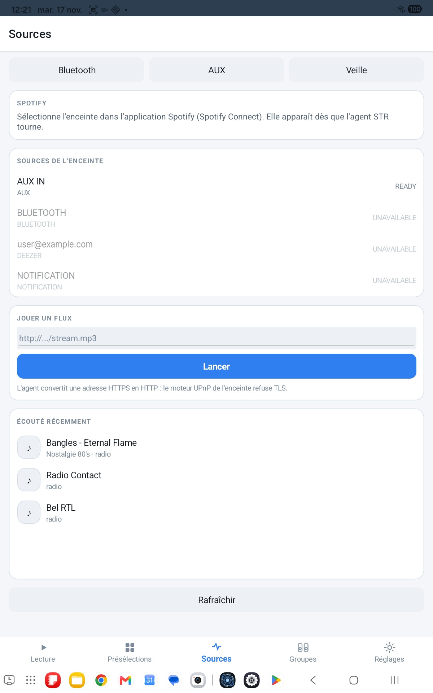

# SoundReborn Remote — Manuel d'utilisation

Version 1.9.2 · Android 7 et suivants

> Langues : **Français** · [English](en.md) · [Deutsch](de.md) · [Nederlands](nl.md) · [Español](es.md) · [Italiano](it.md)

---

## Sommaire

1. [Ce qu'il faut avant de commencer](#1-ce-quil-faut-avant-de-commencer)
2. [Installation](#2-installation)
3. [Premier démarrage](#3-premier-démarrage)
4. [L'onglet Lecture](#4-longlet-lecture)
5. [L'onglet Présélections](#5-longlet-présélections)
6. [L'onglet Sources](#6-longlet-sources)
7. [L'onglet Groupes](#7-longlet-groupes)
8. [L'onglet Réglages](#8-longlet-réglages)
9. [Gestes](#9-gestes)
10. [Que faire si…](#10-que-faire-si)
11. [Limites connues](#11-limites-connues)
12. [Mentions](#12-mentions)

---

## 1. Ce qu'il faut avant de commencer

SoundReborn Remote pilote des enceintes **Bose SoundTouch** depuis un téléphone ou une
tablette Android. Tout se passe sur ton réseau local : aucun compte, aucun service en
ligne, aucune donnée qui sort de chez toi.

Quatre conditions :

- **Le téléphone et les enceintes sur le même Wi-Fi.** Attention aux réseaux invités
  et aux box qui isolent les appareils entre eux : dans ce cas, rien ne se verra.
- **L'agent STR installé sur les enceintes.** C'est lui qui remplace ce que le cloud
  Bose assurait avant son arrêt, le 6 mai 2026. Sans lui, l'application fonctionne
  encore, mais réduite à ce que le firmware seul expose : volume, graves, touches déjà
  enregistrées. La recherche de stations, l'affectation des touches et le groupage
  fiable passent tous par l'agent.
  L'installation se fait avec l'outil STR pour PC ou Mac — <https://st-reborn.de>.
  **Cette application ne l'installe pas** ; elle se contente de signaler les enceintes
  qui ne l'ont pas.
- **Un agent STR 1.8.0 ou plus récent pour modifier les groupes.** Avec un agent plus
  ancien, l'application le signale et ne touche pas aux groupes ; le reste fonctionne.
- **Android 7 ou plus récent.**

---

## 2. Installation

L'application n'est pas distribuée par le Play Store. Elle se télécharge depuis la page
du projet, section *Releases* :
<https://github.com/ben240374/SoundRebornRemote/releases>

1. Télécharge le fichier `.apk` sur le téléphone.
2. Ouvre-le. Android demandera l'autorisation d'installer depuis une source inconnue —
   accepte pour l'application qui a servi au téléchargement (le navigateur, en général).
3. Installe, puis ouvre.

Ensuite, l'application signale elle-même les nouvelles versions et sait les installer
(onglet Réglages, **Mise à jour**).

Aucune autorisation particulière n'est demandée au premier lancement : l'application
n'accède ni aux contacts, ni à la position, ni au stockage.

---

## 3. Premier démarrage

L'application s'ouvre dans la langue du téléphone si elle la connaît — français,
anglais, allemand, néerlandais, espagnol, italien — et en anglais sinon. Tu pourras en changer à
tout moment.

Au premier lancement, aucune enceinte n'est connue. Va dans **Réglages**, puis
**Balayer le réseau local**.

La recherche procède en deux temps. Elle commence par demander aux appareils de
s'annoncer (mDNS) — c'est la voie rapide, deux à trois secondes. Si personne ne répond,
elle interroge une à une les 254 adresses du sous-réseau sur le port 8090, ce qui prend
quelques secondes de plus mais fonctionne même là où le multicast est filtré.

Les enceintes trouvées apparaissent sous **ENCEINTES CONNUES**. Touche **Utiliser** sur
celle que tu veux piloter. Elle est mémorisée : au prochain lancement, l'application s'y
reconnecte seule.

Si le balayage ne trouve rien alors que tu connais l'adresse IP de l'enceinte, saisis-la
dans le champ prévu et touche **Ajouter**.

---

## 4. L'onglet Lecture

C'est l'écran principal, celui qu'on ouvre pour agir vite.

### Le choix de l'enceinte

En haut, une carte par enceinte connue, avec son modèle et la version de son agent STR.
La carte encadrée de bleu est l'enceinte pilotée ; touche une autre carte pour basculer,
sans passer par les réglages.

Le petit point à droite indique la liaison : **direct** signifie que l'enceinte pousse
ses changements en temps réel, **sondage** que l'application les relit à intervalle
régulier. En mode sondage, un changement fait depuis une autre télécommande met une
seconde ou deux à apparaître.

### En ce moment

La pochette, le titre et la source de ce qui joue. Pour une radio, le logo de la station
et son nom ; pour Spotify, la pochette de l'album.

Quand Spotify joue et que l'agent STR est en version 1.8.1 ou plus récente, deux boutons
apparaissent sous le titre : **J'aime** ajoute le morceau en cours aux Titres likés,
**Je n'aime pas** l'en retire, comme les touches pouce de la télécommande. Le morceau va
dans le compte Spotify avec lequel l'**enceinte** est connectée, qui n'est pas forcément
celui de ton téléphone. Une enceinte avec écran affiche « LIKED » ou « REMOVED ».

Pendant une touche Spotify (une présélection qui joue une playlist Spotify), l'enceinte ne
connaît que le nom de la playlist. Avec l'agent STR 1.8.2 ou plus récent, l'application
affiche à la place le morceau, l'artiste et la pochette, avec « Spotify · playlist » comme
source ; le morceau est relu toutes les cinq secondes environ.

Pour une radio internet, l'application affiche aussi le morceau que la station annonce,
comme l'écran de l'enceinte : le titre en grand, l'artiste dessous, et « station · Radio
Internet » comme source. Une station qui n'envoie rien, ou seulement son nom, garde
l'affichage habituel ; un texte sans artiste (une émission, une publicité) s'affiche tel
quel. Le morceau est relu toutes les cinq secondes environ.

### Commandes

Quatre touches : arrêt, précédent, lecture/pause, suivant. Selon la source, certaines
n'ont pas d'effet — une radio en direct ne se rembobine pas.

Le bandeau vert **Veille** éteint l'enceinte ; une fois éteinte, il devient **Allumer**.

Sous le bandeau, **Minuterie de sommeil** met l'enceinte en veille après 15 à 120
minutes. Tant qu'elle tourne, le lien affiche le temps restant ; touche-le pour changer
la durée ou annuler. En groupe, l'application demande s'il faut éteindre tout le groupe
ou seulement l'enceinte sélectionnée. La minuterie vit dans l'agent STR de l'enceinte :
elle continue si tu fermes l'application, mais un redémarrage de l'enceinte l'annule. Le
lien n'apparaît que si l'agent connaît la minuterie.

### Volume

Sourdine, égaliser, moins, curseur, plus. Le pourcentage s'affiche à droite.

Quand l'enceinte fait partie d'un groupe, ce curseur devient **le volume de l'ensemble
du groupe** : le déplacer décale toutes les enceintes du même écart, ce qui préserve
l'équilibre que tu as réglé entre elles. Cuisine à 60 et salon à 30, monter le groupe de
10 donne 70 et 40, pas 70 et 35.

La touche **=**, entre la sourdine et le moins, fait l'inverse : elle met *toutes* les
enceintes du groupe à la valeur affichée. Groupe à 25, tout le monde à 25. Elle
n'apparaît que lorsqu'un groupe est actif — seule, une enceinte n'a rien à égaliser.

Sous le curseur, **Par enceinte** donne une ligne par membre du groupe, avec son propre
curseur et ses touches − et +, pour baisser la cuisine sans toucher au salon. Une
enceinte éteinte apparaît estompée et ne réagit pas : lui envoyer une commande ne ferait
qu'attendre pour rien.

### Graves et présélections

Le réglage des graves va de -10 à +10 selon les modèles. **Il n'y a pas de réglage
d'aigus** : l'API de l'enceinte n'en expose aucun, ce n'est pas un oubli de
l'application.

Les six présélections sont reprises ici pour éviter un changement d'onglet. La tuile
encadrée de vert est celle qui joue.

Quand l'agent STR gère la seconde rangée, deux pastilles **Une fois** et **Deux fois**
apparaissent au-dessus des tuiles : la seconde montre les six stations que l'enceinte
lance quand on presse deux fois une touche. Le choix vaut pour les deux onglets. Chaque tuile porte en haut le nom de sa touche (« Touche 1 » à « Touche 6 », dans les deux
rangées), et la pastille **Deux fois** affiche un petit nombre : combien de touches de la
seconde rangée portent une station.

À droite des pastilles, **Local** remplace les tuiles par tes présélections locales,
gardées dans le téléphone (voir l'onglet Présélections) ; **Une fois** ramène les touches
de l'enceinte. Ces pastilles portent un dessin plutôt
qu'un mot : un doigt levé pour **Une fois**, deux doigts pour **Deux fois**, un téléphone
pour **Local**, une étoile pour **★ STR**. Un appui long affiche leur nom.

La pastille **Une fois** porte elle aussi un petit nombre : combien de touches de la
première rangée portent une station.

**Garder ce qui joue sur une touche**, sous les tuiles, range sur la touche de ton choix
ce que l'enceinte joue en ce moment — station, album ou piste de la bibliothèque.
Spotify, l'AUX et le Bluetooth ne se gardent pas ainsi.

### Message vocal

La carte **Message vocal** fait parler l'enceinte, puis la laisse reprendre ce qu'elle
jouait.

- **Ta voix** : maintiens le bouton rond au micro pendant que tu parles, relâche-le pour
  envoyer (1 minute au plus). Le bouton passe au rouge pendant l'enregistrement. Le
  téléphone garde le message le temps que l'enceinte vienne le chercher, puis l'efface.
- **Un texte** : tape-le sous le bouton, puis **Lire**. L'enceinte le lit avec la voix de
  Google, dans la langue de l'application ; elle doit avoir accès à internet, et le texte
  passe par Google.
- **Garder** range le texte tapé dans la liste des textes gardés (dix au plus). Touche un
  texte gardé pour le faire lire ; **✎** le modifie, **✕** le supprime après confirmation.

Une courte vibration signale que le micro tourne : parle à partir de là. L'application
ajoute un peu de silence avant et après ton message, pour que l'enceinte, qui ouvre son
amplificateur avec un temps de retard, n'en avale pas le début. Un texte compte 200
caractères au plus.

Le curseur **Volume des annonces** règle le volume du message, voix et texte : tout à
gauche, l'enceinte garde son volume ; sinon elle passe à ce volume le temps du message,
puis revient à celui d'avant. Le micro du téléphone ne se règle pas : pour un message plus
fort, monte ce curseur.

Le message part vers l'enceinte qui reçoit les commandes. Il ne passe pas encore sur
toutes les enceintes d'un groupe : c'est prévu dans l'agent STR. La première fois,
Android demande l'accès au micro. La carte n'apparaît qu'avec l'agent STR.

### Grouper avec

Une pastille par enceinte, hors celle qui reçoit les commandes. Touche une pastille pour
joindre cette enceinte au groupe ; une coche et un contour vert apparaissent. Touche-la
de nouveau pour l'en retirer.

Le groupement prend quelques secondes : pendant ce temps, le bloc affiche *Groupement avec … en cours…*, puis le résultat — ou l'erreur, en rouge.

**Le maître se cherche, il ne se suppose pas.** Dans un groupe, une enceinte diffuse et
les autres la suivent. Si tu sélectionnes une enceinte qui suit, l'application le dit —
*Groupé avec …*, en ambre — et adresse le transport, les présélections et le
volume au maître, puisque c'est lui qui diffuse. Sélectionner une enceinte n'interrompt
donc jamais ce que tu es en train d'écouter. La veille et la minuterie de sommeil font
exception : elles visent l'enceinte sélectionnée.

Sur une enceinte qui suit, la pastille cochée est cette enceinte elle-même : la toucher
la fait quitter le groupe. L'extension du groupe se fait depuis le maître, puisque c'est
lui qui le compose.

**Éteindre une enceinte la sort d'abord du groupe**, et dissout le groupe si c'était la
dernière. En la rallumant, tu retrouves une enceinte seule, qui diffuse ce qu'elle a à
diffuser, et que tu peux regrouper.

Le lien **Rafraîchir**, en bas, relit tout : titre en cours, pochette, volume, état du
groupe.

Si l'enceinte que tu ajoutes joue autre chose, ou est en pause, l'application le dit avant
de grouper : « Le Salon joue Radio Contact. L'ajouter au groupe arrête cette écoute pour
jouer Bel RTL. » Rien ne change tant que tu n'as pas touché **Ajouter**. Une enceinte en
veille, ou qui joue déjà la même chose, est ajoutée sans question.

---

## 5. L'onglet Présélections

### Les six touches

Les mêmes que les touches physiques de l'enceinte. Chaque tuile montre le logo de la
station et son débit. Touche-la pour lancer la lecture ; le cadre vert indique celle qui
joue.

Les logos sont téléchargés puis conservés localement. S'ils manquent, la station ne
publie pas d'image exploitable, ou son serveur ne répond pas.

### Une fois, deux fois

Avec un agent STR récent (v1.6 et suivants), chaque touche de l'enceinte porte deux
stations : une pression lance la première, deux pressions rapprochées la seconde. Les
pastilles **Une fois** et **Deux fois** choisissent la rangée affichée ; les tuiles
gardent leur numéro de touche, de ① à ⑥.

La seconde rangée n'existe que dans l'agent : les pastilles n'apparaissent pas sur une
enceinte sans agent, ou dont l'agent est plus ancien.

Une touche qui n'a de station que sur sa seconde rangée apparaît vide en **Une fois** :
une seule pression sur l'enceinte lance alors la station de la seconde rangée (agent
STR 1.6.3 et suivants).

### Présélections « Local »

La pastille **Local**, à droite, montre des présélections gardées dans le téléphone, en
plus des touches de l'enceinte, et en nombre libre (100 au plus). Touche une ligne pour
lancer la radio sur l'enceinte sélectionnée ; **✎** la renomme, **✕** la retire après
confirmation. La ligne de la radio qui joue est en vert.

Pour en ajouter :

- **Ajouter ce qui joue** garde la radio que l'enceinte joue en ce moment, avec l'adresse
  d'origine du flux et son logo ;
- **Ajouter une adresse** demande l'adresse http ou https du flux, puis un nom ;
- dans la recherche, touche une station puis **Ajouter à Local**.

Ces présélections restent dans ce téléphone : les touches de l'enceinte ne les
connaissent pas, et un autre téléphone ne les voit pas. Une playlist Spotify ne peut pas
y être rangée : l'agent STR ne lance une playlist que depuis l'une de ses touches. Pour les garder en cas de réinstallation, exporte-les depuis l'onglet Réglages (**Sauvegarde des favoris**).

### Renommer et effacer une touche

Chaque tuile porte en haut le nom de sa touche. Sur une touche rangée par l'agent STR, deux
petits boutons l'accompagnent : **✎** renomme la touche et **✕** l'efface, après
confirmation. Renommer ne change que le nom affiché : la station, son image et la playlist
d'une touche Spotify restent. Un nom compte 64 caractères au plus. La pastille **Deux fois**
indique combien de touches de la seconde rangée portent une station.

Une touche que seul le firmware de l'enceinte connaît, et une touche vide, n'ont pas ces
boutons : l'agent n'aurait rien à renommer ni à effacer.

### Copier les touches vers une autre enceinte

La carte **Copier les touches** copie toutes les touches de l'enceinte sélectionnée vers
une autre enceinte STR, ou vers toutes. Touche **Copier vers…**, choisis la cible, puis
confirme. Chaque touche réglée ici remplace celle de la cible ; les autres touches de la
cible restent. Les deux rangées partent vers une cible qui en a deux. Quand une touche
Spotify fait partie de la copie, le compte Spotify de cette enceinte est transmis à la
cible : la question de confirmation le rappelle. Le résultat s'affiche par enceinte.

La copie demande l'agent STR 1.6.5 ou plus récent sur l'enceinte sélectionnée.

### Favoris STR

Avec un agent STR récent, le bouton **★ STR**, à droite de **Local** (onglets Lecture et
Présélections), montre à la place des touches les stations étoilées de l'application STR
sur ordinateur. Ce sont les mêmes sur toutes les enceintes STR : un favori ajouté ou
retiré ici l'est aussi sur les autres enceintes et sur l'ordinateur, quelques secondes
plus tard. **Une fois** ou **Deux fois** ramène les touches.

- Toucher un favori le lance sur l'enceinte sélectionnée.
- **⋯** propose **Mettre sur une touche…**, **Ajouter à Local** et **Retirer des favoris
  STR** (après confirmation).
- **★ Ajouter ce qui joue** garde la radio que l'enceinte joue ; dans la recherche,
  **⋯ Touches, Local…** propose **★ Ajouter aux favoris STR**.
- Une station Pandora s'affiche, mais se lance depuis l'application STR.

### Trouver une station

Le champ de recherche interroge **radio-browser.info**, un annuaire ouvert tenu par des
bénévoles. La recherche reprend celle de l'application PC de STR :

- **Pays** (tous par ordre alphabétique, outre-mer compris : Martinique, La Réunion,
  Guadeloupe…) et **Langue** limitent la recherche ; **Trier** range les stations par
  popularité (votes), par écoutes, par tendance, par nom ou par débit. Changer l'un de ces
  choix relance la dernière recherche.
- Les **pastilles de genres** (Tous, Pop, Rock, Tubes, Jazz, Années 80…) filtrent par
  genre ; les deux premières dépendent du pays (Chanson et Levenslied pour la Belgique).
  **Plus de genres** ajoute les genres les plus fréquents de l'annuaire. Sans rien saisir,
  une pastille parcourt l'annuaire, comme la Top liste.
- **Top liste** affiche les stations les plus votées, avec ces filtres.
- Une recherche en plusieurs mots cherche aussi ces mots dans les genres (« rock belge »),
  et trouve un nom écrit avec une autre ponctuation (« Mi Soul » trouve « Mi-Soul »).
- Une adresse de flux collée dans le champ (http://… ou https://…) retrouve la station
  de l'annuaire qui la diffuse ; inconnue, elle s'affiche comme **Adresse collée**, qu'on
  peut écouter ou ranger comme une autre.
- **Voir plus**, sous les résultats, ajoute la page suivante.

**En service uniquement** (coché par défaut) écarte les stations que l'annuaire a trouvées
hors service à son dernier contrôle. Une station qu'on vient d'ajouter à l'annuaire, pas
encore contrôlée, reste visible. Si un nom ne donne que des stations signalées hors
service, elles s'affichent quand même, avec un avertissement : l'annuaire contrôle depuis
l'étranger, et une radio réservée à son pays y paraît morte alors qu'elle joue très bien
chez toi.

**Compatibles Bose uniquement** (coché par défaut, à laisser ainsi) écarte les formats que
les enceintes SoundTouch ne savent pas lire (Ogg, Opus, FLAC), qui produiraient un silence
sans message d'erreur. **Débit** cache les stations sous un débit choisi ; celles dont le
débit est inconnu restent. Ces deux filtres agissent sur la liste reçue, sans nouvelle
recherche, et le nombre de stations masquées s'affiche sous le titre des résultats.

**Une station manque ?** Le lien sous les résultats ouvre radio-browser.info, où chacun
peut l'ajouter : elle devient trouvable ici, et pour tout le monde.

Touche un résultat : la ligne s'ouvre et propose trois choix, sans ambiguïté possible.

- **📱 ▶ Écouter sur ce téléphone** (ou **cette tablette**) : la station joue sur
  l'appareil, pour l'entendre avant de la diffuser. Le bouton devient **📱 ■ Arrêter** ;
  une barre au-dessus des résultats dit ce qui joue, avec **■ Arrêter** et **🔊 Diffuser
  sur …**. Une seule écoute à la fois ; elle s'arrête quand on quitte l'onglet ou
  l'application, et quand on diffuse la station sur l'enceinte. Hors Wi-Fi, elle utilise
  les données mobiles (environ 1 Mo par minute à 128 kbit/s). Si une station ne joue pas
  sur l'appareil, elle peut quand même jouer sur l'enceinte : l'agent STR convertit des
  formats que le lecteur d'Android ne lit pas.
- **🔊 Diffuser sur Cuisine** : avec le nom complet de l'enceinte sélectionnée, la station
  part sur l'enceinte, sans rien enregistrer.
- **⋯ Touches, Local…** ouvre une feuille d'actions avec **Diffuser sur Cuisine**,
  **★ Ajouter aux favoris STR** (agent récent),
  **Ajouter à Local**, puis **① Affecter à cette touche** si la touche est libre, ou
  **① Remplacer Bel RTL** si elle est occupée — le nom de la station déjà présente est
  affiché, pour éviter d'écraser celle à laquelle on tenait.

**L'affectation exige l'agent STR.** Sans lui, seule l'écoute immédiate est possible ;
l'enregistrement se fait alors en maintenant la touche appuyée sur l'enceinte elle-même,
ou depuis l'application STR de bureau.

Avec la seconde rangée, la feuille propose douze touches : **①** à **⑥**, puis **①×2**
à **⑥×2**. Une station ne vit que sur une touche : si elle est déjà rangée ailleurs,
l'agent refuse et l'application dit sur quelle touche elle se trouve.

---

## 6. L'onglet Sources

**Bluetooth**, **AUX** et **Veille** en haut : trois raccourcis directs.

**Spotify** ne se pilote pas depuis cette application. Ouvre Spotify sur ton téléphone et
choisis l'enceinte dans le sélecteur d'appareils (Spotify Connect) : elle y apparaît dès
que l'agent STR tourne.

**Sources de l'enceinte** liste ce que l'enceinte déclare, avec son état : `READY`
signifie disponible, `UNAVAILABLE` que la source existe mais n'est pas utilisable —
typiquement un service de streaming dont le compte n'est plus joignable depuis l'arrêt
du cloud.

**Jouer un flux** accepte l'adresse d'un flux audio direct — un `.mp3` ou un `.m3u8` —
et le lance sur l'enceinte. Utile pour une webradio absente de l'annuaire. Cette
fonction demande l'agent STR.

**Enregistrer** garde sur le téléphone un extrait de la radio internet que joue
l'enceinte, pour le réécouter ou l'envoyer (WhatsApp, e-mail…). Touche **Enregistrer** :
l'enregistrement s'arrête quand tu touches **Arrêter**, ou tout seul après 5 minutes. Il
continue écran éteint : une notification « Enregistrement en cours » affiche le compteur et
un bouton **Arrêter**. Au premier enregistrement, Android 13 et suivants demandent
d'autoriser les notifications ; si tu refuses, l'enregistrement se fait quand même, sans
notification.

Seules les radios internet dont le flux est accessible s'enregistrent : présélections STR,
stations trouvées dans l'annuaire, flux lancés à la main. Spotify, Deezer, Bluetooth et AUX
ne passent pas par le téléphone et ne peuvent pas être enregistrés, pas plus que les flux
HLS (`.m3u8`). Le téléphone ouvre le flux de la radio en parallèle de l'enceinte : l'écoute
n'est pas perturbée, mais l'enregistrement consomme des données, environ 1 Mo par minute.

La liste garde les 10 derniers enregistrements, avec la station, la date et la durée.
▶ les écoute sur le téléphone, ⤴ ouvre le partage d'Android, la corbeille supprime après
confirmation. Au-delà de 10, l'application refuse d'en faire un nouveau : supprime d'abord
celui dont tu n'as plus besoin. Les enregistrements restent dans l'application et
disparaissent si tu la désinstalles. La liste reste disponible même quand aucune enceinte ne répond : seul l'enregistrement est alors impossible.

Pendant l'écoute d'un enregistrement, une barre et un compteur apparaissent sous lui :
« 01:23 / 04:50 », la position et la durée. Fais glisser la barre pour te déplacer dans
l'enregistrement.

**Écouté récemment** reprend l'historique tenu par l'agent : touche une ligne pour
relancer.

Un album ou un dossier de la bibliothèque est relancé en entier, pas seulement sa
première piste. Si le serveur de médias est éteint, l'application le dit au lieu
d'annoncer une lecture qui ne démarre pas.

---

## 7. L'onglet Groupes

**Enceinte maître** indique celle qui diffuse réellement — relevée sur les enceintes
elles-mêmes, et non supposée être celle que tu as sélectionnée.

**Enceintes à grouper** : coche celles qui doivent suivre, puis **Grouper**.
**Dissoudre** défait tout le groupe.

Une enceinte n'appartient qu'à un groupe à la fois, et c'est le maître qui le compose.
Si l'enceinte que tu as sélectionnée en suit une autre, **Grouper** est grisé et un
message te renvoie vers le maître.

L'option **Groupe permanent** demande à l'agent de reformer le groupe à la prochaine
lecture, au lieu de le laisser se défaire quand la musique s'arrête. L'application relit
désormais ce drapeau avant d'étendre un groupe existant et le rend tel quel : ajouter une
enceinte ne rétrograde plus un groupe permanent en groupe ordinaire.

**Volume du groupe** agit sur toutes les enceintes à la fois, en décalant les volumes
sans toucher aux écarts. Cuisine à 60 et salon à 30, monter le groupe de 10 donne 70 et
40, pas 70 et 35. Sous ce curseur, chaque enceinte du groupe a le sien. **Appliquer à
tout le groupe** met tout le monde à la même valeur, ce que fait aussi la touche **=**
de l'onglet Lecture. Ce bloc n'apparaît que lorsqu'un groupe existe.

Un groupe permanent reste tel que tu l'as composé. Mettre une de ses enceintes en veille
la sort du groupe qui joue sans la retirer du groupe enregistré : elle le rejoint à la
prochaine lecture. Et si un groupe permanent attend sa prochaine lecture, l'application
le signale et demande confirmation avant d'en former un autre à sa place.

Si aucun groupe ne joue, qu'un groupe ordinaire est enregistré et que tu coches **Groupe
permanent**, l'application demande aussi confirmation : un groupe permanent que l'agent
garderait de côté derrière lui serait remplacé.

---

## 8. L'onglet Réglages

**Enceinte sélectionnée** : nom, adresse et modèle. C'est l'enceinte que tu as choisie —
pas forcément celle qui reçoit les commandes. Quand elle suit un groupe, une ligne ambre
dit où partent réellement les commandes, et pourquoi.

**Réveils** : ceux de l'enceinte sélectionnée — un réveil ne fait sonner que l'enceinte
sur laquelle il est enregistré, même dans un groupe. Chaque réveil joue une touche (1 à 6,
ou 1 à 6 pressée deux fois), à l'heure et les jours choisis (les raccourcis **Lun → Ven**, **Week-end** et **Tous les jours** cochent les jours d'un coup ; chaque case reste modifiable). On règle aussi son volume
(ou on laisse celui de l'enceinte), l'arrêt automatique et la durée de répétition. La
carte affiche le prochain réveil tel que l'enceinte le prévoit, et prévient si son
horloge n'est pas encore à l'heure. Si le fuseau horaire de l'enceinte est vide (UTC),
celui du téléphone est enregistré avec le réveil suivant. Les réveils modifiés ailleurs —
page téléphone STR, application de bureau — ne sont pas écrasés : l'application
n'enregistre que ce que tu as changé. Agent STR requis. L'heure se règle sur le cadran du téléphone. La corbeille d'une ligne supprime le réveil, après confirmation.

**Volume de départ** : le niveau que prend l'enceinte quand on l'allume et qu'elle se met
à jouer. Coche la case, choisis le niveau, puis **Enregistrer le volume de départ**. Un
volume réglé pendant l'écoute n'est jamais modifié.

**Touche de répétition** (dans la carte des réveils) : coche la touche de la télécommande
qui répète un réveil qui sonne — **AUX**, **Pouce levé** ou **Pouce baissé** — puis
**Enregistrer la touche de répétition**. Hors réveil, un pouce ne fait rien et AUX passe
sur l'entrée AUX comme d'habitude. Un pouce qui porte déjà une autre action (minuterie de
sommeil, graves…) l'indique ; la cocher la remplace, et l'application le dit avant.
Seules les cases que tu changes sont écrites : une action réglée ailleurs sur une autre
touche reste. Une touche qui porte un groupe enregistré est refusée par l'enceinte, qui
dit pourquoi.

**Langue** : français, anglais, allemand, néerlandais, espagnol, italien. Le changement est
immédiat, sans redémarrage, et il est mémorisé.

**Thème** : Système, Clair ou Foncé. « Système » suit le réglage d'affichage du
téléphone, y compris sa bascule automatique le soir.

**Recherche** : le balayage du réseau, et la saisie manuelle d'une adresse IP. La
découverte interroge d'abord le mDNS et ne balaie le sous-réseau que si elle ne trouve
rien. Le balayage est restreint aux plages d'adresses privées : il n'atteint donc jamais
un réseau mobile ni un tunnel VPN.

**Enceintes connues** : la liste mémorisée. **Utiliser** bascule dessus, **✕** l'oublie.
Une enceinte marquée **« Pas de STR — prête pour l'installation »** répond correctement
mais n'a pas l'agent ; un bloc explicatif apparaît alors plus bas, avec un lien vers le
site du projet STR.

Une enceinte dont l'agent est antérieur à la version 1.8.0 fait apparaître un bloc
semblable, **Agent STR trop ancien**, et sa carte dans l'onglet Lecture porte la mention
« trop ancien ».

**Agent STR : nouvelle version** : au plus une fois par jour, à l'ouverture des Réglages,
l'application lit sur GitHub la dernière version de l'agent STR. Quand des enceintes
connues ont un agent plus ancien, une carte les nomme, avec **Nouveautés** et **Plus
tard** (la carte revient à la version suivante), et leur carte dans l'onglet Lecture porte
« 1.9.1 dispo ». L'agent se met à jour avec l'application STR sur ordinateur. La case
**Vérifier automatiquement** de la carte **Mise à jour** coupe aussi cette lecture.

**Diagnostic** : *Interroger l'enceinte* porte sur l'enceinte **sélectionnée** — nom,
modèle, identifiant, version du firmware, l'agent avec son port et sa version relue en
direct sur 17008 et 8888, l'état des notifications, la plage de graves, la liste des
points d'API reconnus, et ce que chaque enceinte connue déclare de la zone en cours.
C'est l'information à joindre à un signalement de problème. *Vider le cache des logos*
force le retéléchargement des images de stations.

**Sauvegarde des favoris** : les présélections « Local » et les textes gardés du message
vocal ne vivent que dans le téléphone. Une mise à jour les garde ; une désinstallation les
efface, y compris celle qu'Android impose avant d'installer un APK signé d'une autre clé.
**Exporter** crée un fichier et ouvre le partage (Drive, e-mail, Fichiers…) ; **Importer**
relit un tel fichier et ajoute ce qui manque, sans rien remplacer ni supprimer.

**Sauvegarde de l'enceinte** : **Sauvegarder dans un fichier** garde ce que l'agent STR
conserve pour l'enceinte sélectionnée — les touches 1 à 12 (une touche Spotify avec sa
playlist), les réveils, le volume de départ et la touche de répétition. **Restaurer depuis
un fichier…** les remet, après une question qui nomme l'enceinte visée et celle d'où vient
le fichier : il sert aussi à recopier ces réglages sur une autre enceinte. Les touches du
fichier remplacent celles de l'enceinte, les autres restent ; ses réveils sont remplacés.
Sans seconde rangée sur l'enceinte visée, les touches 7 à 12 sont passées. Le compte rendu
dit ce qui a été restauré et ce que l'enceinte a refusé. Le groupe permanent n'est pas
sauvegardé. Une touche Spotify ne joue que si l'enceinte est connectée au même compte
Spotify. Agent STR requis.

**Mise à jour** (version installée depuis GitHub) : l'application regarde au plus une
fois par jour, auprès de GitHub, si une version plus récente est publiée ; la case
**Vérifier automatiquement** le coupe. **Vérifier maintenant** le fait à la demande. Quand
une version existe, une bannière apparaît aussi dans l'onglet Lecture (**Nouveautés**,
**Plus tard**, **Installer**). **Installer** télécharge l'APK, vérifie qu'il a exactement
la taille et l'empreinte SHA-256 publiées sur GitHub, puis ouvre l'installateur d'Android,
où tu confirmes. La première fois, Android demande d'autoriser SoundReborn Remote à
installer des applications. Android refuse d'installer par-dessus un APK signé d'une
autre clé : une version de test lancée depuis Visual Studio ne se met pas à jour ainsi.

**À propos** : la version, le crédit au projet STR avec un lien vers son site dans la
langue choisie, et les mentions légales.

---

## 9. Gestes

**Balayer horizontalement** fait passer d'un onglet au suivant ou au précédent :
Lecture → Présélections → Sources → Groupes → Réglages. Le geste doit être franc et
rapide ; un glissement lent n'est pas interprété comme un changement d'onglet.

Un balayage qui commence **sur un curseur** est capté par le curseur : c'est voulu, sans
quoi le volume deviendrait impossible à régler. Commence le geste sur une zone neutre.

**Appui long sur l'icône de l'application** (lanceur d'Android) : **Tout en veille** met
en veille chaque enceinte connue qui a l'agent STR — une enceinte sans agent n'est pas
touchée, car sa seule commande de veille l'allumerait si elle était éteinte —, et
**Touche 1** à **Touche 3** lancent la touche sur l'enceinte sélectionnée. L'application
s'ouvre sur l'onglet Lecture et dit ce qui a été fait. On peut poser ces raccourcis sur
l'écran d'accueil.

---

## 10. Que faire si…

**Le balayage ne trouve aucune enceinte.**
Vérifie que le téléphone est sur le même Wi-Fi que les enceintes, et non sur le réseau
invité ni sur les données mobiles. Certaines box isolent les appareils entre eux : ce
réglage porte souvent le nom d'*isolation AP* ou de *mode client*. Si tu connais
l'adresse IP, saisis-la à la main dans Réglages.

**L'enceinte apparaît, mais rien ne répond.**
Elle est probablement en veille profonde. Réveille-la avec le bouton d'alimentation de
l'onglet Lecture, ou touche une touche physique de l'enceinte.

**Une présélection ne fait rien.**
Une touche vide n'a rien à lancer. Vérifie aussi que l'enceinte n'est pas éteinte.

**Aucun logo de station ne s'affiche.**
Vide le cache des logos dans le diagnostic. Si le problème persiste pour une station
précise, c'est son propre serveur d'images qui est en cause.

**La version de l'agent est absente sur une enceinte.**
Soit l'agent n'y est pas installé, soit il est trop ancien pour publier son numéro de
version. Relance un balayage.

**Le groupe ne se forme pas.**
Les deux enceintes doivent être allumées et joignables. Si l'une d'elles n'a pas l'agent
STR, le groupage passe par le firmware, moins fiable et parfois refusé sans message.

**L'application est dans la mauvaise langue.**
Réglages → Langue. Le choix prime sur la langue du téléphone.

**Le bouton Enregistrer est grisé.**
Le message sous le titre en donne la raison : rien ne joue, la source n'est pas une radio
internet, ou l'adresse du flux de cette station n'est pas connue. Relance la station depuis
une présélection ou l'annuaire, puis rouvre l'onglet Sources.

**L'enceinte ne joue pas le message vocal.**
Le message sous la carte en donne la raison. Si l'enceinte n'est pas venue le chercher, le
Wi-Fi isole sans doute les appareils (réseau invité). Un appui trop bref n'envoie rien :
garde le doigt sur le bouton pendant que tu parles. Le texte lu demande que l'enceinte ait
accès à internet. Quand un message n'est pas parti, **Réessayer**, à côté de la raison, le renvoie tel quel,
sans le réenregistrer.

**Mes présélections « Local » ont disparu après une mise à jour.**
Une mise à jour normale les garde. Elles disparaissent quand l'application a été
désinstallée — Android l'exige pour passer d'une version signée d'une autre clé, par
exemple d'une version de test lancée depuis Visual Studio à la version publiée. Exporte-les
dans Réglages → **Sauvegarde des favoris** avant, puis importe le fichier.

---

## 11. Limites connues

- **Pas de réglage des aigus.** L'API de l'enceinte n'en expose aucun.
- **L'application n'installe pas l'agent STR.** Cela demande un accès système à
  l'enceinte et un redémarrage ; c'est le travail de l'outil STR pour PC ou Mac.
- **Spotify se pilote depuis Spotify**, par Spotify Connect.
- **Pas de parcours de bibliothèque DLNA** pour le moment.
- **Android uniquement.** Il n'existe pas de version iOS.
- **Seconde rangée, minuterie et « garder ce qui joue » demandent un agent STR récent.**
  Sur un agent plus ancien, ces commandes n'apparaissent pas ou sont refusées.
- **Paires stéréo.** L'application ne crée ni ne défait de paire stéréo. Une paire ne
  peut pas diriger un groupe ; avec un agent STR 1.6.3 ou plus récent, elle peut en
  rejoindre un, lancé depuis une autre enceinte.
- **Enregistrement : radios internet seulement**, 5 minutes au plus par enregistrement,
  10 enregistrements gardés.
- **Copie des touches : agent STR 1.6.5 ou plus récent** sur l'enceinte source.
- **« J'aime » et « Je n'aime pas » : agent STR 1.8.1 ou plus récent.** Le titre va dans le
  compte Spotify avec lequel l'enceinte est connectée.
- **Renommer et effacer une touche : agent STR 1.8.0 ou plus récent ; le morceau d'une
  touche Spotify : 1.8.2 ou plus récent.**
- **Message vocal : l'enceinte sélectionnée seulement.** L'annonce sur tout un groupe
  attend l'agent STR. Le texte lu passe par la voix de Google : il quitte ton réseau, et
  l'enceinte doit avoir accès à internet.
- **Présélections « Local » : radios seulement**, gardées dans ce téléphone.

---

## 12. Mentions

SoundReborn Remote est un projet personnel, publié sous licence MIT.

Il n'est **ni produit ni approuvé par Bose Corporation**. « Bose » et « SoundTouch » sont
des marques de Bose Corporation, citées ici uniquement pour indiquer la compatibilité.

Il est **indépendant du projet STR** : ni développé, ni maintenu, ni pris en charge par
lui. Les problèmes rencontrés avec cette application sont à signaler
[sur son dépôt](https://github.com/ben240374/SoundRebornRemote/issues), et non au projet
STR.

L'agent **STR (SoundTouch Reborn)** est l'œuvre de Jens Roggenfelder
([JRpersonal](https://github.com/JRpersonal/streborn)) — <https://st-reborn.de>. Sans
lui, cette application n'aurait rien à piloter.

L'annuaire de stations est fourni par [radio-browser.info](https://www.radio-browser.info).

Le code a été écrit avec Claude (Anthropic).
