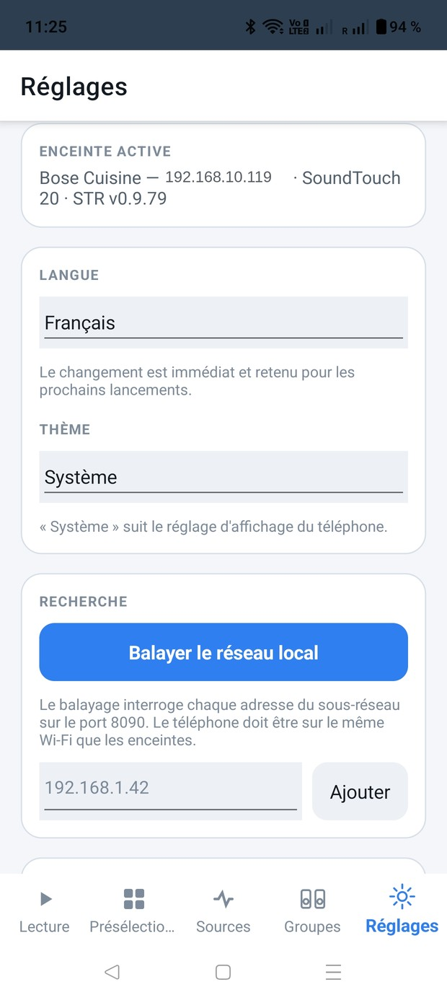
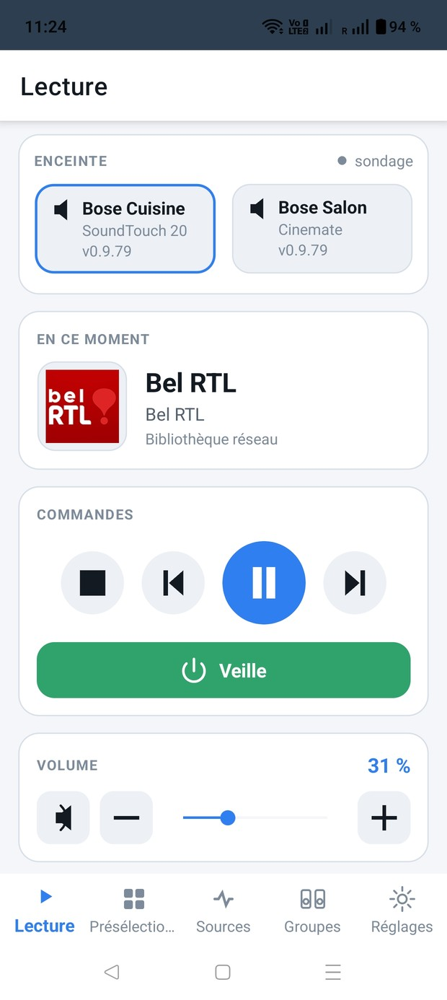
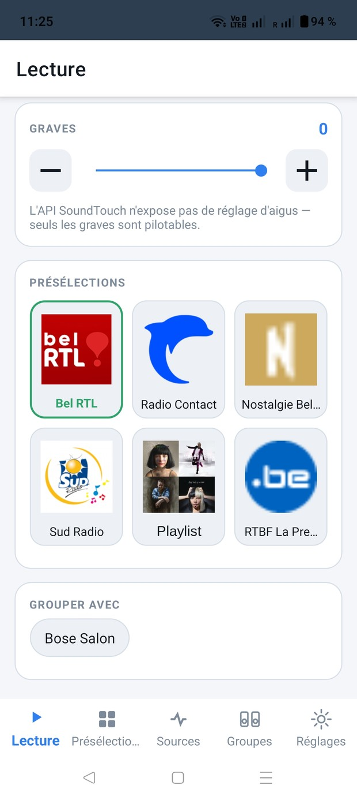
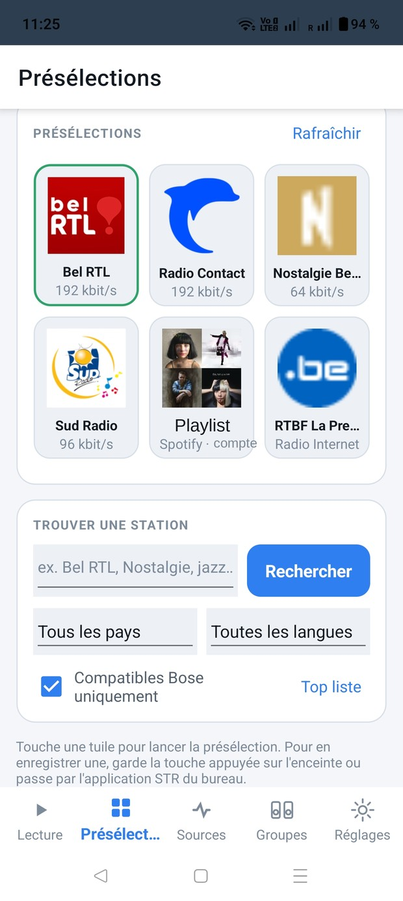
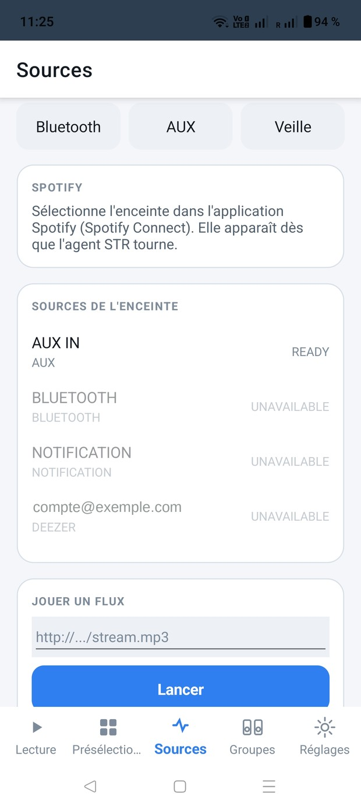
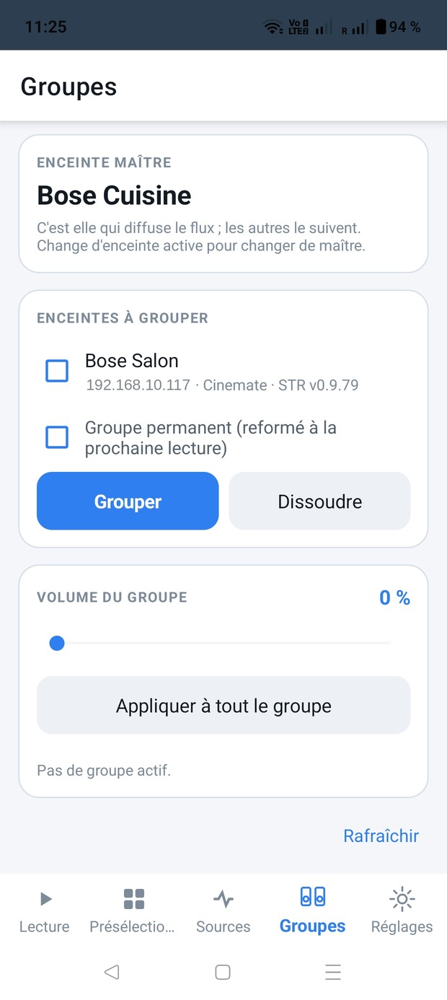
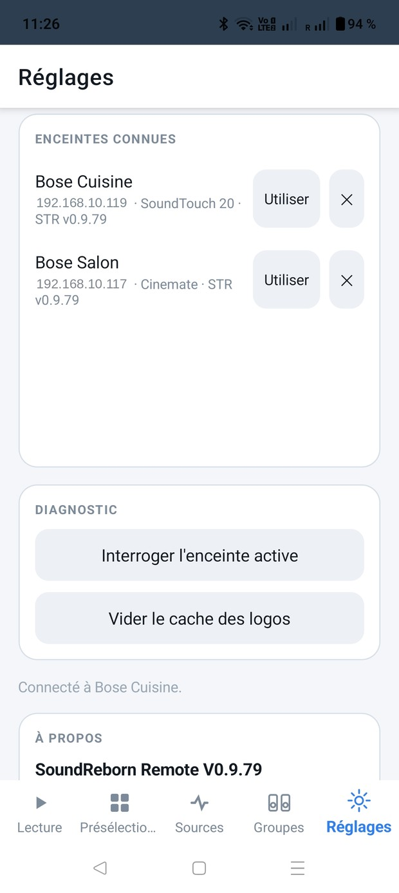

# SoundReborn Remote — Manuel d'utilisation

Version 0.9.82 · Android 7 et suivants

> Langues : **Français** · [English](en.md) · [Deutsch](de.md) · [Nederlands](nl.md) · [Español](es.md)

---

## Sommaire

1. [Ce qu'il faut avant de commencer](#1-ce-quil-faut-avant-de-commencer)
2. [Installation](#2-installation)
3. [Premier démarrage](#3-premier-démarrage)
4. [L'onglet Lecture](#4-longlet-lecture)
5. [L'onglet Présélections](#5-longlet-présélections)
6. [L'onglet Sources](#6-longlet-sources)
7. [L'onglet Groupes](#7-longlet-groupes)
8. [L'onglet Réglages](#8-longlet-réglages)
9. [Gestes](#9-gestes)
10. [Que faire si…](#10-que-faire-si)
11. [Limites connues](#11-limites-connues)
12. [Mentions](#12-mentions)

---

## 1. Ce qu'il faut avant de commencer

SoundReborn Remote pilote des enceintes **Bose SoundTouch** depuis un téléphone ou une
tablette Android. Tout se passe sur ton réseau local : aucun compte, aucun service en
ligne, aucune donnée qui sort de chez toi.

Trois conditions :

- **Le téléphone et les enceintes sur le même Wi-Fi.** Attention aux réseaux invités
  et aux box qui isolent les appareils entre eux : dans ce cas, rien ne se verra.
- **L'agent STR installé sur les enceintes.** C'est lui qui remplace ce que le cloud
  Bose assurait avant son arrêt, le 6 mai 2026. Sans lui, l'application fonctionne
  encore, mais réduite à ce que le firmware seul expose : volume, graves, touches déjà
  enregistrées. La recherche de stations, l'affectation des touches et le groupage
  fiable passent tous par l'agent.
  L'installation se fait avec l'outil STR pour PC ou Mac — <https://st-reborn.de>.
  **Cette application ne l'installe pas** ; elle se contente de signaler les enceintes
  qui ne l'ont pas.
- **Android 7 ou plus récent.**

---

## 2. Installation

L'application n'est pas distribuée par le Play Store. Elle se télécharge depuis la page
du projet, section *Releases* :
<https://github.com/ben240374/SoundRebornRemote/releases>

1. Télécharge le fichier `.apk` sur le téléphone.
2. Ouvre-le. Android demandera l'autorisation d'installer depuis une source inconnue —
   accepte pour l'application qui a servi au téléchargement (le navigateur, en général).
3. Installe, puis ouvre.

Aucune autorisation particulière n'est demandée au premier lancement : l'application
n'accède ni aux contacts, ni à la position, ni au stockage.

---

## 3. Premier démarrage

L'application s'ouvre dans la langue du téléphone si elle la connaît — français,
anglais, allemand, néerlandais, espagnol — et en anglais sinon. Tu pourras en changer à
tout moment.

Au premier lancement, aucune enceinte n'est connue. Va dans **Réglages**, puis
**Balayer le réseau local**.

La recherche procède en deux temps. Elle commence par demander aux appareils de
s'annoncer (mDNS) — c'est la voie rapide, deux à trois secondes. Si personne ne répond,
elle interroge une à une les 254 adresses du sous-réseau sur le port 8090, ce qui prend
quelques secondes de plus mais fonctionne même là où le multicast est filtré.

Les enceintes trouvées apparaissent sous **ENCEINTES CONNUES**. Touche **Utiliser** sur
celle que tu veux piloter. Elle est mémorisée : au prochain lancement, l'application s'y
reconnecte seule.

Si le balayage ne trouve rien alors que tu connais l'adresse IP de l'enceinte, saisis-la
dans le champ prévu et touche **Ajouter**.

---

## 4. L'onglet Lecture

C'est l'écran principal, celui qu'on ouvre pour agir vite.

### Le choix de l'enceinte

En haut, une carte par enceinte connue, avec son modèle et la version de son agent STR.
La carte encadrée de bleu est l'enceinte pilotée ; touche une autre carte pour basculer,
sans passer par les réglages.

Le petit point à droite indique la liaison : **direct** signifie que l'enceinte pousse
ses changements en temps réel, **sondage** que l'application les relit à intervalle
régulier. En mode sondage, un changement fait depuis une autre télécommande met une
seconde ou deux à apparaître.

### En ce moment

La pochette, le titre et la source de ce qui joue. Pour une radio, le logo de la station
et son nom ; pour Spotify, la pochette de l'album.

### Commandes

Quatre touches : arrêt, précédent, lecture/pause, suivant. Selon la source, certaines
n'ont pas d'effet — une radio en direct ne se rembobine pas.

Le bandeau vert **Veille** éteint l'enceinte ; une fois éteinte, il devient **Allumer**.

### Volume

Sourdine, égaliser, moins, curseur, plus. Le pourcentage s'affiche à droite.

Quand l'enceinte fait partie d'un groupe, ce curseur devient **le volume de l'ensemble
du groupe** : le déplacer décale toutes les enceintes du même écart, ce qui préserve
l'équilibre que tu as réglé entre elles. Cuisine à 60 et salon à 30, monter le groupe de
10 donne 70 et 40, pas 70 et 35.

La touche **=**, entre la sourdine et le moins, fait l'inverse : elle met *toutes* les
enceintes du groupe à la valeur affichée. Groupe à 25, tout le monde à 25. Elle
n'apparaît que lorsqu'un groupe est actif — seule, une enceinte n'a rien à égaliser.

Sous le curseur, **Par enceinte** donne une ligne par membre du groupe, avec son propre
curseur et ses touches − et +, pour baisser la cuisine sans toucher au salon. Une
enceinte éteinte apparaît estompée et ne réagit pas : lui envoyer une commande ne ferait
qu'attendre pour rien.

### Graves et présélections

Le réglage des graves va de -10 à +10 selon les modèles. **Il n'y a pas de réglage
d'aigus** : l'API de l'enceinte n'en expose aucun, ce n'est pas un oubli de
l'application.

Les six présélections sont reprises ici pour éviter un changement d'onglet. La tuile
encadrée de vert est celle qui joue.

### Grouper avec

Une pastille par enceinte, hors celle qui reçoit les commandes. Touche une pastille pour
joindre cette enceinte au groupe ; une coche et un contour vert apparaissent. Touche-la
de nouveau pour l'en retirer.

**Le maître se cherche, il ne se suppose pas.** Dans un groupe, une enceinte diffuse et
les autres la suivent. Si tu sélectionnes une enceinte qui suit, l'application le dit —
*Groupé avec …*, en ambre — et adresse le transport, les présélections, la veille et le
volume au maître, puisque c'est lui qui diffuse. Sélectionner une enceinte n'interrompt
donc jamais ce que tu es en train d'écouter.

Sur une enceinte qui suit, la pastille cochée est cette enceinte elle-même : la toucher
la fait quitter le groupe. L'extension du groupe se fait depuis le maître, puisque c'est
lui qui le compose.

**Éteindre une enceinte la sort d'abord du groupe**, et dissout le groupe si c'était la
dernière. En la rallumant, tu retrouves une enceinte seule, qui diffuse ce qu'elle a à
diffuser, et que tu peux regrouper.

Le lien **Rafraîchir**, en bas, relit tout : titre en cours, pochette, volume, état du
groupe.

---

## 5. L'onglet Présélections

### Les six touches

Les mêmes que les touches physiques de l'enceinte. Chaque tuile montre le logo de la
station et son débit. Touche-la pour lancer la lecture ; le cadre vert indique celle qui
joue.

Les logos sont téléchargés puis conservés localement. S'ils manquent, la station ne
publie pas d'image exploitable, ou son serveur ne répond pas.

### Trouver une station

Le champ de recherche interroge **radio-browser.info**, un annuaire ouvert tenu par des
bénévoles. Deux listes déroulantes limitent la recherche à un pays et à une langue, et
**Top liste** affiche les stations les plus écoutées sans rien saisir.

La case **Compatibles Bose uniquement** est cochée par défaut, et il vaut mieux la
laisser ainsi : elle écarte les formats que les enceintes SoundTouch ne savent pas lire
(Ogg, Opus, FLAC), qui produiraient un silence sans message d'erreur.

Touche un résultat : une feuille d'actions s'ouvre, avec

- **Écouter** — lance la station tout de suite, sans rien enregistrer ;
- **① Affecter à cette touche** si la touche est libre, ou **① Remplacer Bel RTL** si
  elle est occupée — le nom de la station déjà présente est affiché, pour éviter
  d'écraser celle à laquelle on tenait.

**L'affectation exige l'agent STR.** Sans lui, seule l'écoute immédiate est possible ;
l'enregistrement se fait alors en maintenant la touche appuyée sur l'enceinte elle-même,
ou depuis l'application STR de bureau.

---

## 6. L'onglet Sources

**Bluetooth**, **AUX** et **Veille** en haut : trois raccourcis directs.

**Spotify** ne se pilote pas depuis cette application. Ouvre Spotify sur ton téléphone et
choisis l'enceinte dans le sélecteur d'appareils (Spotify Connect) : elle y apparaît dès
que l'agent STR tourne.

**Sources de l'enceinte** liste ce que l'enceinte déclare, avec son état : `READY`
signifie disponible, `UNAVAILABLE` que la source existe mais n'est pas utilisable —
typiquement un service de streaming dont le compte n'est plus joignable depuis l'arrêt
du cloud.

**Jouer un flux** accepte l'adresse d'un flux audio direct — un `.mp3` ou un `.m3u8` —
et le lance sur l'enceinte. Utile pour une webradio absente de l'annuaire. Cette
fonction demande l'agent STR.

**Écouté récemment** reprend l'historique tenu par l'agent : touche une ligne pour
relancer.

---

## 7. L'onglet Groupes

**Enceinte maître** indique celle qui diffuse réellement — relevée sur les enceintes
elles-mêmes, et non supposée être celle que tu as sélectionnée.

**Enceintes à grouper** : coche celles qui doivent suivre, puis **Grouper**.
**Dissoudre** défait tout le groupe.

Une enceinte n'appartient qu'à un groupe à la fois, et c'est le maître qui le compose.
Si l'enceinte que tu as sélectionnée en suit une autre, **Grouper** est grisé et un
message te renvoie vers le maître.

L'option **Groupe permanent** demande à l'agent de reformer le groupe à la prochaine
lecture, au lieu de le laisser se défaire quand la musique s'arrête. L'application relit
désormais ce drapeau avant d'étendre un groupe existant et le rend tel quel : ajouter une
enceinte ne rétrograde plus un groupe permanent en groupe ordinaire.

**Volume du groupe** agit sur toutes les enceintes à la fois, en décalant les volumes
sans toucher aux écarts. Cuisine à 60 et salon à 30, monter le groupe de 10 donne 70 et
40, pas 70 et 35. Sous ce curseur, chaque enceinte du groupe a le sien. **Appliquer à
tout le groupe** met tout le monde à la même valeur, ce que fait aussi la touche **=**
de l'onglet Lecture.

---

## 8. L'onglet Réglages

**Enceinte sélectionnée** : nom, adresse et modèle. C'est l'enceinte que tu as choisie —
pas forcément celle qui reçoit les commandes. Quand elle suit un groupe, une ligne ambre
dit où partent réellement les commandes, et pourquoi.

**Langue** : français, anglais, allemand, néerlandais, espagnol. Le changement est
immédiat, sans redémarrage, et il est mémorisé.

**Thème** : Système, Clair ou Foncé. « Système » suit le réglage d'affichage du
téléphone, y compris sa bascule automatique le soir.

**Recherche** : le balayage du réseau, et la saisie manuelle d'une adresse IP. La
découverte interroge d'abord le mDNS et ne balaie le sous-réseau que si elle ne trouve
rien. Le balayage est restreint aux plages d'adresses privées : il n'atteint donc jamais
un réseau mobile ni un tunnel VPN.

**Enceintes connues** : la liste mémorisée. **Utiliser** bascule dessus, **✕** l'oublie.
Une enceinte marquée **« Pas de STR — prête pour l'installation »** répond correctement
mais n'a pas l'agent ; un bloc explicatif apparaît alors plus bas, avec un lien vers le
site du projet STR.

**Diagnostic** : *Interroger l'enceinte* porte sur l'enceinte **sélectionnée** — nom,
modèle, identifiant, version du firmware, l'agent avec son port et sa version relue en
direct sur 17008 et 8888, l'état des notifications, la plage de graves, la liste des
points d'API reconnus, et ce que chaque enceinte connue déclare de la zone en cours.
C'est l'information à joindre à un signalement de problème. *Vider le cache des logos*
force le retéléchargement des images de stations.

**À propos** : la version, le crédit au projet STR avec un lien vers son site dans la
langue choisie, et les mentions légales.

---

## 9. Gestes

**Balayer horizontalement** fait passer d'un onglet au suivant ou au précédent :
Lecture → Présélections → Sources → Groupes → Réglages. Le geste doit être franc et
rapide ; un glissement lent n'est pas interprété comme un changement d'onglet.

Un balayage qui commence **sur un curseur** est capté par le curseur : c'est voulu, sans
quoi le volume deviendrait impossible à régler. Commence le geste sur une zone neutre.

---

## 10. Que faire si…

**Le balayage ne trouve aucune enceinte.**
Vérifie que le téléphone est sur le même Wi-Fi que les enceintes, et non sur le réseau
invité ni sur les données mobiles. Certaines box isolent les appareils entre eux : ce
réglage porte souvent le nom d'*isolation AP* ou de *mode client*. Si tu connais
l'adresse IP, saisis-la à la main dans Réglages.

**L'enceinte apparaît, mais rien ne répond.**
Elle est probablement en veille profonde. Réveille-la avec le bouton d'alimentation de
l'onglet Lecture, ou touche une touche physique de l'enceinte.

**Une présélection ne fait rien.**
Une touche vide n'a rien à lancer. Vérifie aussi que l'enceinte n'est pas éteinte.

**Aucun logo de station ne s'affiche.**
Vide le cache des logos dans le diagnostic. Si le problème persiste pour une station
précise, c'est son propre serveur d'images qui est en cause.

**La version de l'agent est absente sur une enceinte.**
Soit l'agent n'y est pas installé, soit il est trop ancien pour publier son numéro de
version. Relance un balayage.

**Le groupe ne se forme pas.**
Les deux enceintes doivent être allumées et joignables. Si l'une d'elles n'a pas l'agent
STR, le groupage passe par le firmware, moins fiable et parfois refusé sans message.

**L'application est dans la mauvaise langue.**
Réglages → Langue. Le choix prime sur la langue du téléphone.

---

## 11. Limites connues

- **Pas de réglage des aigus.** L'API de l'enceinte n'en expose aucun.
- **L'application n'installe pas l'agent STR.** Cela demande un accès système à
  l'enceinte et un redémarrage ; c'est le travail de l'outil STR pour PC ou Mac.
- **Spotify se pilote depuis Spotify**, par Spotify Connect.
- **Pas de parcours de bibliothèque DLNA** pour le moment.
- **Android uniquement.** Il n'existe pas de version iOS.

---

## 12. Mentions

SoundReborn Remote est un projet personnel, publié sous licence MIT.

Il n'est **ni produit ni approuvé par Bose Corporation**. « Bose » et « SoundTouch » sont
des marques de Bose Corporation, citées ici uniquement pour indiquer la compatibilité.

Il est **indépendant du projet STR** : ni développé, ni maintenu, ni pris en charge par
lui. Les problèmes rencontrés avec cette application sont à signaler
[sur son dépôt](https://github.com/ben240374/SoundRebornRemote/issues), et non au projet
STR.

L'agent **STR (SoundTouch Reborn)** est l'œuvre de Jens Roggenfelder
([JRpersonal](https://github.com/JRpersonal/streborn)) — <https://st-reborn.de>. Sans
lui, cette application n'aurait rien à piloter.

L'annuaire de stations est fourni par [radio-browser.info](https://www.radio-browser.info).

Le code a été écrit avec Claude (Anthropic).
