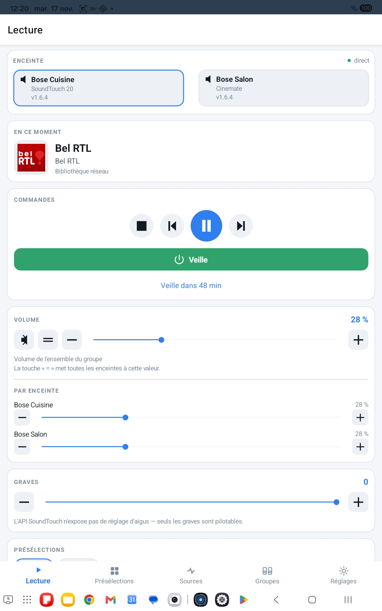
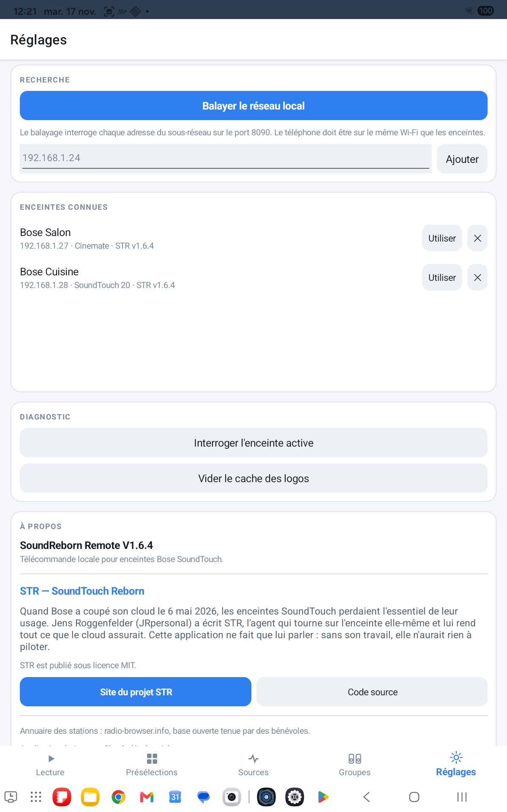

# SoundReborn Remote — Manuale d'uso

Versione 1.9.0 · Android 7 e successivi

> Lingue: [Français](fr.md) · [English](en.md) · [Deutsch](de.md) · [Nederlands](nl.md) · [Español](es.md) · **Italiano**

---

## Indice

1. [Cosa serve prima](#1-cosa-serve-prima)
2. [Installazione](#2-installazione)
3. [Primo avvio](#3-primo-avvio)
4. [La scheda Riproduzione](#4-la-scheda-riproduzione)
5. [La scheda Preselezioni](#5-la-scheda-preselezioni)
6. [La scheda Sorgenti](#6-la-scheda-sorgenti)
7. [La scheda Gruppi](#7-la-scheda-gruppi)
8. [La scheda Impostazioni](#8-la-scheda-impostazioni)
9. [Gesti](#9-gesti)
10. [Cosa fare se…](#10-cosa-fare-se)
11. [Limiti noti](#11-limiti-noti)
12. [Note legali](#12-note-legali)

---

## 1. Cosa serve prima

SoundReborn Remote comanda i diffusori **Bose SoundTouch** da un telefono o da un tablet
Android. Tutto avviene sulla tua rete locale: nessun account, nessun servizio online,
nessun dato che esce da casa.

Quattro condizioni:

- **Telefono e diffusori sulla stessa rete Wi-Fi.** Attenzione alle reti ospiti e ai
  router che isolano i dispositivi tra loro: in quel caso non verrà trovato nulla.
- **L'agente STR installato sui diffusori.** Sostituisce ciò che forniva il cloud Bose fino
  alla sua chiusura, il 6 maggio 2026. Senza di esso l'app funziona ancora, ma si limita a
  ciò che espone il solo firmware: volume, bassi, preselezioni già memorizzate. La ricerca
  delle stazioni, l'assegnazione delle preselezioni e i gruppi affidabili passano tutti
  dall'agente. L'installazione si fa con lo strumento STR per PC o Mac —
  <https://st-reborn.de>. **Questa app non lo installa**; segnala soltanto i diffusori che
  ne sono privi.
- **Un agente STR 1.8.0 o successivo per modificare i gruppi.** Con un agente più vecchio,
  l'app lo dice e non tocca i gruppi; tutto il resto funziona.
- **Android 7 o successivo.**

---

## 2. Installazione

L'app non è distribuita tramite il Play Store. Scaricala dalla pagina *Releases* del
progetto: <https://github.com/ben240374/SoundRebornRemote/releases>

1. Scarica il file `.apk` sul telefono.
2. Aprilo. Android chiederà il permesso di installare da una fonte sconosciuta: concedilo
   all'app che ha fatto il download, di solito il browser.
3. Installa, poi apri.

Al primo avvio non viene chiesto nessun permesso particolare: l'app non tocca né i
contatti, né la posizione, né la memoria.

---

## 3. Primo avvio

L'app si apre nella lingua del telefono se la conosce — francese, inglese, tedesco,
olandese, spagnolo, italiano — e in inglese altrimenti. Puoi cambiarla in qualsiasi
momento.

Al primo avvio non è conosciuto nessun diffusore. Vai in **Impostazioni**, poi **Cerca
nella rete locale**.

La ricerca avviene in due tempi. Prima chiede ai dispositivi di annunciarsi (mDNS): è la
via rapida, due o tre secondi. Se nessuno risponde, interroga uno per uno i 254 indirizzi
della sottorete sulla porta 8090 — qualche secondo in più, ma funziona anche dove il
multicast è filtrato.

I diffusori trovati compaiono sotto **DIFFUSORI CONOSCIUTI**. Tocca **Usa** su quello che
vuoi comandare. Viene ricordato: al prossimo avvio l'app vi si ricollega da sola.

Se la ricerca non trova nulla ma conosci l'indirizzo IP del diffusore, scrivilo nel campo
previsto e tocca **Aggiungi**.

---

## 4. La scheda Riproduzione

La schermata principale, quella che apri per agire in fretta.

### Scegliere il diffusore

In alto, una scheda per ogni diffusore conosciuto, con il modello e la versione
dell'agente STR. La scheda bordata di blu è quella comandata; tocca un'altra scheda per
cambiare, senza passare dalle impostazioni.

Il pallino a destra indica il collegamento: **in diretta** significa che il diffusore
invia i suoi cambiamenti in tempo reale, **interrogazione** che l'app li rilegge a
intervalli. In questo secondo caso, una modifica fatta da un altro telecomando impiega un
secondo o due a comparire.

### Ora

La copertina, il titolo e la sorgente di ciò che suona. Per una radio, il suo logo e il
suo nome; per Spotify, la copertina dell'album.

Quando suona Spotify e l'agente STR è alla versione 1.8.1 o successiva, sotto il titolo
compaiono due pulsanti: **Mi piace** aggiunge il brano in corso ai Brani che ti piacciono,
**Non mi piace** lo toglie, come i tasti con il pollice del telecomando. Il brano va
nell'account Spotify con cui è collegato il **diffusore**, che non è per forza quello del
tuo telefono. Un diffusore con display mostra «LIKED» o «REMOVED».

Durante un tasto Spotify (una preselezione che riproduce una playlist Spotify), il
diffusore conosce solo il nome della playlist. Con l'agente STR 1.8.2 o successivo, l'app
mostra al suo posto il brano, l'artista e la copertina, con «Spotify · playlist» come
sorgente; il brano viene riletto circa ogni cinque secondi.

Per una radio internet, l'app mostra anche il brano che la stazione annuncia, come il
display del diffusore: il titolo in grande, l'artista sotto e «stazione · Radio internet»
come sorgente. Una stazione che non invia nulla, o solo il proprio nome, mantiene la
visualizzazione abituale; un testo senza artista (un programma, una pubblicità) è mostrato
così com'è. Il brano viene riletto circa ogni cinque secondi.

### Comandi

Quattro tasti: stop, precedente, riproduci/pausa, successivo. A seconda della sorgente
alcuni non hanno effetto: un flusso radio in diretta non si può riavvolgere.

La barra verde **Standby** spegne il diffusore; una volta spento, diventa **Accendi**.

Sotto la barra, **Timer di spegnimento** manda il diffusore in standby dopo un tempo da 15
a 120 minuti. Mentre è attivo, il collegamento mostra il tempo rimanente; toccalo per
cambiare la durata o annullare. In un gruppo, l'app chiede se spegnere tutto il gruppo o
solo il diffusore selezionato. Il timer vive nell'agente STR del diffusore: continua se
chiudi l'app, ma un riavvio del diffusore lo annulla. Il collegamento compare solo se
l'agente conosce il timer.

### Volume

Muto, livello, meno, cursore, più. La percentuale è indicata a destra.

Quando il diffusore fa parte di un gruppo, questo cursore diventa **il volume di tutto il
gruppo**: spostarlo sposta ogni diffusore della stessa quantità, e così l'equilibrio che hai
impostato tra loro resta. Se la cucina è a 60 e il soggiorno a 30, alzare il gruppo di 10 dà
70 e 40, non 70 e 35.

Il tasto **=**, tra muto e meno, fa il contrario: porta *ogni* diffusore del gruppo al
valore indicato. Gruppo a 25, tutti a 25. Compare solo quando un gruppo è attivo: da solo,
un diffusore non ha nulla da livellare.

Sotto il cursore, **Per diffusore** elenca ogni membro del gruppo con il suo cursore e i
suoi tasti − e +, così puoi abbassare la cucina senza toccare il soggiorno. Un diffusore
spento appare attenuato e non reagisce: mandargli un comando farebbe solo aspettare l'app
per niente.

### Bassi e preselezioni

I bassi vanno da -10 a +10 a seconda del modello. **Non c'è regolazione degli acuti**:
l'API del diffusore non ne offre — non è una dimenticanza dell'app.

Le sei preselezioni sono ripetute qui per risparmiare un cambio di scheda. Il riquadro
bordato di verde è quello che suona.

Quando l'agente STR gestisce la seconda fila, sopra i riquadri compaiono due pulsanti,
**Una volta** e **Due volte**: il secondo mostra le sei stazioni che il diffusore avvia
quando si preme due volte un tasto. La scelta vale per entrambe le schede. Ogni riquadro
porta in alto il nome del suo tasto («Tasto 1» – «Tasto 6», in entrambe le file), e il
pulsante **Due volte** porta un piccolo numero: quanti tasti della seconda fila hanno una
stazione.

A destra dei pulsanti, **Locale** sostituisce i riquadri con le tue preselezioni locali,
salvate nel telefono (vedi la scheda Preselezioni); **Una volta** riporta i tasti del
diffusore.

Anche il pulsante **Una volta** porta un piccolo numero: quanti tasti della prima fila
hanno una stazione.

**Salva su un tasto ciò che suona**, sotto i riquadri, memorizza sul tasto che scegli ciò
che il diffusore riproduce in questo momento — stazione, album o brano della libreria.
Spotify, AUX e Bluetooth non si possono salvare in questo modo.

### Messaggio vocale

La scheda **Messaggio vocale** fa parlare il diffusore, poi lo lascia riprendere ciò che
suonava.

- **La tua voce**: tieni premuto il pulsante rotondo del microfono mentre parli, rilascialo
  per inviare (1 minuto al massimo). Durante la registrazione il pulsante diventa rosso. Il
  telefono conserva il messaggio finché il diffusore non viene a prenderlo, poi lo cancella.
- **Un testo**: scrivilo sotto il pulsante, poi **Leggi**. Il diffusore lo legge con la voce
  di Google, nella lingua dell'app; deve avere accesso a internet, e il testo passa da
  Google.
- **Salva** aggiunge il testo scritto all'elenco dei testi salvati (dieci al massimo). Tocca
  un testo salvato per farlo leggere; **✎** lo modifica, **✕** lo elimina dopo conferma.

Una breve vibrazione segnala che il microfono è in funzione: parla da quel momento.
L'app aggiunge un po' di silenzio prima e dopo il messaggio, perché il diffusore, che apre
l'amplificatore con un ritardo, non ne inghiotta l'inizio. Un testo conta al massimo 200
caratteri.

Il cursore **Volume degli annunci** regola il volume del messaggio, voce e testo: tutto a
sinistra, il diffusore mantiene il suo volume; altrimenti passa a quel volume per il
messaggio, poi torna a quello di prima. Il microfono del telefono non si regola: per un
messaggio più forte, alza questo cursore.

Il messaggio va al diffusore che riceve i comandi. Non suona ancora su tutti i diffusori di
un gruppo: è previsto nell'agente STR. La prima volta Android chiede l'accesso al
microfono. La scheda compare solo con l'agente STR.

### Raggruppa con

Un pulsante per ogni diffusore, tranne quello a cui vanno i comandi. Tocca un pulsante per
aggiungere quel diffusore al gruppo; compaiono una spunta e un bordo verde. Toccalo di
nuovo per toglierlo.

Il raggruppamento richiede qualche secondo: nel frattempo il riquadro mostra
*Raggruppamento con …*, poi il risultato — o l'errore, in rosso.

**Il diffusore principale viene trovato, non presunto.** In un gruppo, un diffusore
trasmette e gli altri lo seguono. Se selezioni un diffusore che segue, l'app lo dice —
*Raggruppato con …* in ambra — e invia trasporto, preselezioni e volume al principale,
perché è lui che suona. Selezionare un diffusore quindi non interrompe mai ciò che stai
ascoltando. Standby e timer di spegnimento fanno eccezione: agiscono sul diffusore
selezionato.

Su un diffusore che segue, il pulsante spuntato è il diffusore stesso: toccarlo lo fa
uscire dal gruppo. Il gruppo si allarga dal diffusore principale, perché è lui che lo
compone.

**Spegnere un diffusore lo toglie prima dal gruppo**, e scioglie il gruppo se era l'ultimo
membro. Riaccenderlo ti restituisce un diffusore da solo, che suona ciò che suona, e che
puoi raggruppare di nuovo.

Il collegamento **Aggiorna** in fondo rilegge tutto: titolo in corso, copertina, volume,
stato del gruppo.

Se il diffusore che aggiungi suona qualcos'altro, o è in pausa, l'app lo dice prima di
raggruppare: «Salon sta riproducendo Radio Contact. Aggiungerlo al gruppo interrompe questo
ascolto per riprodurre Bel RTL.» Non cambia nulla finché non tocchi **Aggiungi**. Un
diffusore in standby, o che suona già la stessa cosa, viene aggiunto senza domanda.

---

## 5. La scheda Preselezioni

### I sei tasti

Gli stessi sei dei tasti fisici del diffusore. Ogni riquadro mostra il logo della stazione
e il suo bitrate. Tocca per avviare la riproduzione; il bordo verde indica quello che suona.

I loghi vengono scaricati e poi conservati sul telefono. Quando ne manca uno, la stazione
non pubblica un'immagine utilizzabile, oppure il suo server non risponde.

### Una volta, due volte

Con un agente STR recente (v1.6 e successivi), ogni tasto del diffusore porta due
stazioni: una pressione avvia la prima, due pressioni rapide la seconda. I pulsanti **Una
volta** e **Due volte** scelgono la fila mostrata; i riquadri mantengono il numero del
tasto, da ① a ⑥.

La seconda fila esiste solo nell'agente: i pulsanti non compaiono su un diffusore senza
agente, o con un agente più vecchio.

Un tasto che ha una stazione solo sulla seconda fila appare vuoto sotto **Una volta**: una
sola pressione sul diffusore avvia allora la stazione della seconda fila (agente STR 1.6.3
e successivi).

### Preselezioni «Locale»

Il pulsante **Locale**, a destra, mostra preselezioni salvate nel telefono, oltre ai tasti
del diffusore e in numero libero (100 al massimo). Tocca una riga per avviare la radio sul
diffusore scelto; **✎** la rinomina, **✕** la rimuove dopo conferma. La riga della radio in
riproduzione è verde.

Per aggiungerne:

- **Aggiungi ciò che suona** salva la radio che il diffusore riproduce in questo momento,
  con l'indirizzo originale del flusso e il suo logo;
- **Aggiungi un indirizzo** chiede l'indirizzo http o https del flusso, poi un nome;
- nella ricerca, tocca una stazione, poi **Aggiungi a Locale**.

Queste preselezioni restano in questo telefono: i tasti del diffusore non le conoscono, e
un altro telefono non le vede. Una playlist Spotify non può esservi salvata: l'agente STR
avvia una playlist solo da uno dei suoi tasti. Per conservarle in caso di reinstallazione, esportale dalla scheda Impostazioni (**Backup dei preferiti**).

### Rinominare e cancellare un tasto

Ogni riquadro porta in alto il nome del suo tasto. Su un tasto memorizzato dall'agente STR,
accanto ci sono due piccoli pulsanti: **✎** rinomina il tasto e **✕** lo cancella, dopo
conferma. Rinominare cambia solo il nome mostrato: la stazione, la sua immagine e la
playlist di un tasto Spotify restano. Un nome conta al massimo 64 caratteri. Il pulsante
**Due volte** indica quanti tasti della seconda fila hanno una stazione.

Un tasto che conosce solo il firmware del diffusore, e un tasto vuoto, non hanno questi
pulsanti: l'agente non avrebbe nulla da rinominare né da cancellare.

### Copiare i tasti su un altro diffusore

Il riquadro **Copia i tasti** copia tutti i tasti del diffusore selezionato su un altro
diffusore STR, o su tutti. Tocca **Copia su…**, scegli la destinazione, poi conferma. Ogni
tasto impostato qui sostituisce quello di destinazione; gli altri tasti di destinazione
restano. Entrambe le file vanno a una destinazione che ne ha due. Quando un tasto Spotify fa
parte della copia, l'account Spotify di questo diffusore viene trasmesso alla destinazione:
la domanda di conferma lo dice. Il risultato è mostrato per diffusore.

La copia richiede l'agente STR 1.6.5 o successivo sul diffusore selezionato.

### Trovare una stazione

La casella di ricerca interroga **radio-browser.info**, un elenco aperto curato da
volontari. La ricerca segue quella dell'app desktop di STR:

- **Paese** e **Lingua** restringono la ricerca; **Ordina** dispone le stazioni per
  popolarità (voti), ascolti, tendenza, nome o bitrate. Cambiare una di queste scelte
  ripete l'ultima ricerca.
- Le **etichette dei generi** (Tutti, Pop, Rock, Successi, Jazz, Anni '80…) filtrano per
  genere; le prime due dipendono dal paese (Italo e Italian per l'Italia). **Altri
  generi** aggiunge i generi più frequenti dell'elenco. Senza scrivere nulla, un'etichetta
  sfoglia l'elenco, come Le più ascoltate.
- **Le più ascoltate** mostra le stazioni più votate, con questi filtri.
- Una ricerca di più parole cerca quelle parole anche nei generi («rock belge»), e trova un
  nome scritto con un'altra punteggiatura («Mi Soul» trova «Mi-Soul»).
- Un indirizzo di flusso incollato nella casella (http://… o https://…) trova la stazione
  dell'elenco che lo trasmette; se è sconosciuto compare come **Indirizzo incollato**, che
  puoi ascoltare o salvare come le altre.
- **Mostra altre**, sotto i risultati, aggiunge la pagina successiva.

**Solo stazioni attive** (spuntata in partenza) esclude le stazioni che l'elenco ha trovato
non attive all'ultimo controllo. Una stazione appena aggiunta, non ancora controllata,
resta visibile. Se un nome trova solo stazioni segnalate come non attive, vengono mostrate
comunque, con un avviso: l'elenco controlla dall'estero, e una radio limitata al suo paese
lì sembra spenta mentre a casa tua funziona benissimo.

**Solo compatibili Bose** (spuntata in partenza, meglio lasciarla così) esclude i formati
che i diffusori SoundTouch non sanno decodificare (Ogg, Opus, FLAC), che darebbero silenzio
senza alcun messaggio d'errore. **Bitrate** nasconde le stazioni sotto un bitrate scelto;
quelle con bitrate sconosciuto restano. Entrambi i filtri agiscono sulla lista ricevuta,
senza nuova ricerca, e il numero di stazioni nascoste compare sotto il titolo dei
risultati.

**Manca una stazione?** Il link sotto i risultati apre radio-browser.info, dove chiunque può
aggiungerla: comparirà qui, e per tutti.

Tocca un risultato e si apre un menu con

- **Ascolta ora** — riproduce subito la stazione, senza memorizzare nulla;
- **① Assegna a questo tasto** se il tasto è libero, oppure **① Sostituisci Bel RTL** se è
  occupato — il nome della stazione già presente è indicato, così non sovrascrivi quella a
  cui tenevi.

**L'assegnazione richiede l'agente STR.** Senza di esso è possibile solo l'ascolto
immediato; la memorizzazione si fa allora tenendo premuto il tasto sul diffusore stesso,
oppure dall'app STR per computer.

Con la seconda fila, il menu offre dodici tasti: da **①** a **⑥**, poi da **①×2** a
**⑥×2**. Una stazione occupa un solo tasto: se è già memorizzata altrove, l'agente rifiuta
e l'app indica il tasto che la porta.

---

## 6. La scheda Sorgenti

**Bluetooth**, **AUX** e **Standby** in alto: tre scorciatoie dirette.

**Spotify** non si comanda da questa app. Apri Spotify sul telefono e scegli il diffusore
nel selettore dei dispositivi (Spotify Connect): compare lì non appena l'agente STR è in
funzione.

**Sorgenti del diffusore** elenca ciò che il diffusore dichiara, con il suo stato: `READY`
significa disponibile, `UNAVAILABLE` che la sorgente esiste ma non si può usare — di solito
un servizio di streaming il cui account non è più raggiungibile dalla chiusura del cloud.

**Riprodurre un flusso** accetta l'indirizzo di un flusso audio diretto — un `.mp3` o un
`.m3u8` — e lo avvia sul diffusore. Utile per una web radio assente dall'elenco. Richiede
l'agente STR.

**Registra** conserva sul telefono un estratto della radio internet che suona sul
diffusore, per riascoltarlo o inviarlo (WhatsApp, e-mail…). Tocca **Registra**: la
registrazione si ferma quando tocchi **Ferma**, o da sola dopo 5 minuti. Continua anche a
schermo spento: una notifica «Registrazione» mostra il contatore e un pulsante **Ferma**.
Alla prima registrazione, Android 13 e successivi chiedono di consentire le notifiche; se
rifiuti, la registrazione funziona comunque, senza la notifica.

Si registrano solo le radio internet il cui flusso è raggiungibile: preselezioni STR,
stazioni trovate nell'elenco, flussi avviati a mano. Spotify, Deezer, Bluetooth e AUX non
passano dal telefono e non si possono registrare, come pure i flussi HLS (`.m3u8`). Il
telefono apre il flusso della stazione accanto al diffusore: l'ascolto non viene
disturbato, ma la registrazione consuma dati, circa 1 MB al minuto.

L'elenco conserva le ultime 10 registrazioni, con la stazione, la data e la durata. ▶ le
riproduce sul telefono, ⤴ apre il menu di condivisione di Android, il cestino elimina dopo
conferma. Oltre 10, l'app non ne fa una nuova: elimina prima quella che non ti serve più. Le
registrazioni restano nell'app e vengono eliminate se la disinstalli. L'elenco resta
disponibile anche quando nessun diffusore risponde: è impossibile solo registrare.

Durante l'ascolto di una registrazione, sotto di essa compaiono una barra e un contatore:
«01:23 / 04:50», la posizione e la durata. Trascina la barra per spostarti nella
registrazione.

**Ascoltati di recente** mostra la cronologia conservata dall'agente: tocca una riga per
riavviarla.

Un album o una cartella della libreria vengono riprodotti per intero, non solo il primo
brano. Se il server multimediale è spento, l'app lo dice invece di annunciare una
riproduzione che non parte mai.

---

## 7. La scheda Gruppi

**Diffusore principale** indica quello che trasmette davvero — letto dai diffusori stessi,
non presunto come quello che hai selezionato.

**Diffusori da raggruppare**: spunta quelli che devono seguire, poi **Raggruppa**.
**Sciogli** scioglie tutto il gruppo.

Un diffusore appartiene a un solo gruppo alla volta, ed è il principale che lo compone. Se
il diffusore che hai selezionato ne segue un altro, **Raggruppa** è disattivato e un
messaggio ti indirizza al principale.

L'opzione **Gruppo permanente** chiede all'agente di ricomporre il gruppo alla prossima
riproduzione, invece di lasciarlo sciogliere quando la musica si ferma. Prima di allargare
un gruppo esistente, l'app rilegge questa opzione e la ripassa invariata: aggiungere un
diffusore non trasforma più un gruppo permanente in un gruppo normale.

**Volume del gruppo** agisce su tutti i diffusori insieme, spostando i volumi e mantenendo
le differenze. Se la cucina è a 60 e il soggiorno a 30, alzare il gruppo di 10 dà 70 e 40 —
non 70 e 35. Sotto quel cursore, ogni diffusore del gruppo ha il suo. **Applica a tutto il
gruppo** porta tutti allo stesso valore, come fa il tasto **=** nella scheda Riproduzione.
Questo riquadro compare solo quando esiste un gruppo.

Un gruppo permanente resta come l'hai costruito. Mettere in standby uno dei suoi diffusori
lo toglie dal gruppo che suona senza toglierlo dal gruppo salvato: rientra alla prossima
riproduzione. E quando un gruppo permanente aspetta la sua prossima riproduzione, l'app lo
dice e chiede conferma prima di formarne un altro al suo posto.

Se nessun gruppo suona, è salvato un gruppo normale e tu spunti **Gruppo permanente**,
l'app chiede anche in questo caso: un gruppo permanente che l'agente tiene da parte dietro
di esso verrebbe sostituito.

---

## 8. La scheda Impostazioni

**Diffusore selezionato**: nome, indirizzo e modello. È il diffusore che hai scelto — non
per forza quello che riceve i comandi. Quando segue un gruppo, una riga in ambra dice dove
vanno davvero i comandi, e perché.

**Sveglie**: quelle del diffusore selezionato — una sveglia suona solo sul diffusore su cui
è salvata, anche in un gruppo. Ogni sveglia riproduce un tasto (da 1 a 6, o da 1 a 6 premuto
due volte) all'ora e nei giorni che scegli (le scorciatoie **Lun → Ven**, **Weekend** e **Tutti i giorni** spuntano i giorni in un colpo; ogni casella resta modificabile). Imposti anche il suo volume (o mantieni quello
del diffusore), lo spegnimento automatico e la durata del posticipo. La scheda mostra la
prossima sveglia come la prevede il diffusore, e avvisa quando il suo orologio non è ancora
impostato. Se il fuso orario del diffusore è vuoto (UTC), quello del telefono viene salvato
con la prossima sveglia. Le sveglie modificate altrove — la pagina STR del telefono, l'app
per computer — non vengono sovrascritte: l'app salva solo ciò che hai cambiato. Richiede
l'agente STR. L'ora si imposta sul quadrante dell'orologio del telefono. Il cestino su una
riga elimina la sveglia, dopo conferma.

**Volume di avvio**: il livello che il diffusore assume quando viene acceso e inizia a
suonare. Spunta la casella, scegli il livello, poi **Salva il volume di avvio**. Un volume
regolato durante l'ascolto non viene mai modificato.

**Lingua**: italiano, francese, inglese, tedesco, olandese, spagnolo. La modifica è
immediata, senza riavvio, e viene ricordata.

**Tema**: Sistema, Chiaro o Scuro. «Sistema» segue l'impostazione di visualizzazione del
telefono, compreso il passaggio automatico della sera.

**Ricerca**: la ricerca nella rete, e l'inserimento manuale per indirizzo IP. La scoperta
interroga prima mDNS e scandisce la sottorete solo se non trova nulla. La scansione è
limitata agli intervalli di indirizzi privati, quindi non raggiunge mai una rete mobile o
un tunnel VPN.

**Diffusori conosciuti**: l'elenco memorizzato. **Usa** passa a uno di essi, **✕** lo
dimentica. Un diffusore segnato **«Senza STR — pronto per l'installazione»** risponde bene
ma non ha l'agente; più in basso compare allora un riquadro esplicativo, con un
collegamento al sito del progetto STR.

Un diffusore il cui agente è precedente alla versione 1.8.0 fa comparire un riquadro
simile, **Agente STR troppo vecchio**, e la sua scheda nella scheda Riproduzione indica
«troppo vecchio».

**Diagnostica**: *Interroga il diffusore attivo* riporta i dati del diffusore
**selezionato** — nome, modello, identificativo, versione del firmware, l'agente con la sua
porta e la sua versione lette in diretta su 17008 e 8888, lo stato delle notifiche,
l'intervallo dei bassi, l'elenco degli endpoint API riconosciuti, e ciò che ogni diffusore
conosciuto dichiara sulla zona attuale. Sono le informazioni da allegare a una
segnalazione. *Svuota la cache dei loghi* obbliga a scaricare di nuovo le immagini delle
stazioni.

**Backup dei preferiti**: le preselezioni «Locale» e i testi salvati del messaggio vocale
vivono solo nel telefono. Un aggiornamento li conserva; una disinstallazione li cancella,
compresa quella che Android impone prima di installare un APK firmato con un'altra chiave.
**Esporta** crea un file e apre la condivisione (Drive, e-mail, File…); **Importa** rilegge
un tale file e aggiunge ciò che manca, senza sostituire né eliminare nulla.

**Informazioni**: la versione, il ringraziamento al progetto STR con un collegamento al suo
sito, e le note legali.

---

## 9. Gesti

**Uno scorrimento orizzontale** passa alla scheda successiva o precedente: Riproduzione →
Preselezioni → Sorgenti → Gruppi → Impostazioni. Il gesto deve essere deciso; un
trascinamento lento non viene letto come un cambio di scheda.

Uno scorrimento che parte **su un cursore** viene preso dal cursore: è voluto, altrimenti
il volume diventerebbe impossibile da regolare. Inizia il gesto su una zona neutra.

---

## 10. Cosa fare se…

**La ricerca non trova nessun diffusore.**
Verifica che il telefono sia sulla stessa rete Wi-Fi dei diffusori, non sulla rete ospiti
né sui dati mobili. Alcuni router isolano i dispositivi tra loro — l'impostazione si chiama
di solito *isolamento AP* o *modalità client*. Se conosci l'indirizzo IP, inseriscilo a
mano nelle Impostazioni.

**Il diffusore compare ma non risponde nulla.**
Probabilmente è in standby profondo. Riattivalo con il pulsante di accensione della scheda
Riproduzione, o premi un tasto fisico sul diffusore.

**Una preselezione non fa nulla.**
Un tasto vuoto non ha nulla da avviare. Verifica anche che il diffusore non sia spento.

**Non compare nessun logo delle stazioni.**
Svuota la cache dei loghi nella diagnostica. Se il problema resta per una stazione in
particolare, la causa è il suo server di immagini.

**Su un diffusore manca la versione dell'agente.**
O l'agente non è installato, o è troppo vecchio per pubblicare il suo numero di versione.
Avvia di nuovo la ricerca.

**Il gruppo non si forma.**
Entrambi i diffusori devono essere accesi e raggiungibili. Se uno dei due non ha l'agente
STR, il raggruppamento passa dal firmware, meno affidabile, che a volte rifiuta senza
messaggio.

**L'app è nella lingua sbagliata.**
Impostazioni → Lingua. La tua scelta prevale sulla lingua del telefono.

**Il pulsante Registra è disattivato.**
Il messaggio sotto il titolo ne dà il motivo: non suona nulla, la sorgente non è una radio
internet, oppure l'indirizzo del flusso di questa stazione è sconosciuto. Riavvia la
stazione da una preselezione o dall'elenco, poi riapri la scheda Sorgenti.

**Il diffusore non riproduce il messaggio vocale.**
Il messaggio sotto la scheda ne indica il motivo. Se il diffusore non è venuto a prenderlo,
probabilmente il Wi-Fi isola i dispositivi (rete ospiti). Una pressione troppo breve non
invia nulla: tieni il dito sul pulsante mentre parli. Il testo letto richiede che il
diffusore abbia accesso a internet. Se un messaggio non è partito, **Riprova**, accanto al motivo, lo rinvia così com'è,
senza registrarlo di nuovo.

**Le mie preselezioni «Locale» sono sparite dopo un aggiornamento.**
Un aggiornamento normale le conserva. Spariscono quando l'app è stata disinstallata —
Android lo impone per passare a una versione firmata con un'altra chiave, per esempio da una
versione di prova avviata da Visual Studio alla versione pubblicata. Esportale prima in
Impostazioni → **Backup dei preferiti**, poi importa il file.

---

## 11. Limiti noti

- **Nessuna regolazione degli acuti.** L'API del diffusore non ne offre.
- **L'app non installa l'agente STR.** Servono un accesso di sistema al diffusore e un
  riavvio; è il compito dello strumento STR per PC o Mac.
- **Spotify si comanda da Spotify**, tramite Spotify Connect.
- **Nessuna navigazione nella libreria DLNA** per ora.
- **Solo Android.** Non esiste una versione iOS.
- **La seconda fila, il timer di spegnimento e «salva ciò che suona» richiedono un agente
  STR recente.** Con un agente più vecchio questi comandi non compaiono o vengono rifiutati.
- **Coppie stereo.** L'app non crea né scioglie una coppia stereo. Una coppia non può
  guidare un gruppo; con un agente STR 1.6.3 o successivo può unirsi a un gruppo avviato su
  un altro diffusore.
- **Registrazione: solo radio internet**, al massimo 5 minuti per registrazione, 10
  registrazioni conservate.
- **Copia dei tasti: agente STR 1.6.5 o successivo** sul diffusore di origine.
- **Mi piace e Non mi piace: agente STR 1.8.1 o successivo.** Il brano va nell'account
  Spotify con cui è collegato il diffusore.
- **Rinominare e cancellare i tasti: agente STR 1.8.0 o successivo; il brano di un tasto
  Spotify: 1.8.2 o successivo.**
- **Messaggio vocale: solo il diffusore scelto.** Un annuncio su un intero gruppo aspetta
  l'agente STR. Il testo letto passa dalla voce di Google: esce dalla tua rete, e il
  diffusore deve avere accesso a internet.
- **Preselezioni «Locale»: solo radio**, salvate in questo telefono.

---

## 12. Note legali

SoundReborn Remote è un progetto personale, distribuito con licenza MIT.

**Non è prodotto né approvato da Bose Corporation.** «Bose» e «SoundTouch» sono marchi di
Bose Corporation, citati qui solo per indicare la compatibilità.

È **indipendente dal progetto STR**: non è realizzato, mantenuto né supportato da esso. I
problemi di questa app vanno segnalati
[sul suo repository](https://github.com/ben240374/SoundRebornRemote/issues), non al
progetto STR.

L'agente **STR (SoundTouch Reborn)** è opera di Jens Roggenfelder
([JRpersonal](https://github.com/JRpersonal/streborn)) — <https://st-reborn.de>. Senza di
esso, questa app non avrebbe nulla da comandare.

L'elenco delle stazioni è fornito da [radio-browser.info](https://www.radio-browser.info).

Il codice è stato scritto con Claude (Anthropic).
