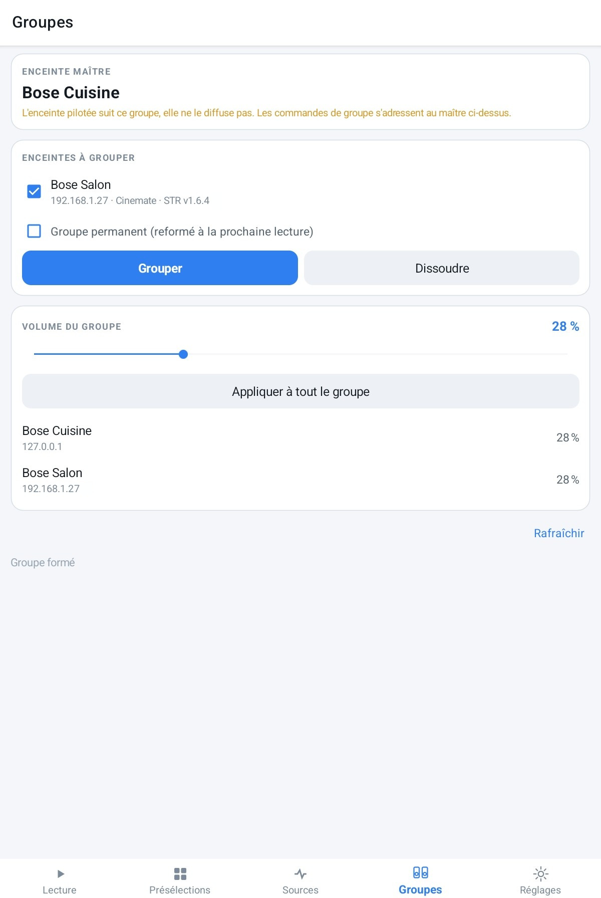

# SoundReborn Remote — Handleiding

Versie 1.9.0 · Android 7 en hoger

> Talen: [Français](fr.md) · [English](en.md) · [Deutsch](de.md) · **Nederlands** · [Español](es.md) · [Italiano](it.md)

---

## Inhoud

1. [Wat je vooraf nodig hebt](#1-wat-je-vooraf-nodig-hebt)
2. [Installeren](#2-installeren)
3. [Eerste start](#3-eerste-start)
4. [Het tabblad Afspelen](#4-het-tabblad-afspelen)
5. [Het tabblad Presets](#5-het-tabblad-presets)
6. [Het tabblad Bronnen](#6-het-tabblad-bronnen)
7. [Het tabblad Groepen](#7-het-tabblad-groepen)
8. [Het tabblad Instellingen](#8-het-tabblad-instellingen)
9. [Gebaren](#9-gebaren)
10. [Wat te doen als…](#10-wat-te-doen-als)
11. [Bekende beperkingen](#11-bekende-beperkingen)
12. [Vermeldingen](#12-vermeldingen)

---

## 1. Wat je vooraf nodig hebt

SoundReborn Remote bedient **Bose SoundTouch**-speakers vanaf een Android-telefoon of
-tablet. Alles gebeurt op je eigen netwerk: geen account, geen onlinedienst, geen
gegevens die het huis verlaten.

Vier voorwaarden:

- **Telefoon en speakers op dezelfde wifi.** Let op gastnetwerken en modems die apparaten
  van elkaar afschermen — dan wordt er niets gevonden.
- **De STR-agent op de speakers.** Die vervangt wat de Bose-cloud deed tot ze op
  6 mei 2026 werd uitgezet. Zonder de agent werkt de app nog wel, maar beperkt tot wat de
  firmware alleen biedt: volume, bass, al opgeslagen toetsen. Zenders zoeken, toetsen
  toewijzen en betrouwbaar groeperen lopen allemaal via de agent.
  Installeren gebeurt met het STR-programma voor pc of Mac — <https://st-reborn.de>.
  **Deze app installeert hem niet**; ze wijst alleen de speakers aan die hem missen.
- **Een STR-agent 1.8.0 of nieuwer om groepen te wijzigen.** Met een oudere agent meldt
  de app dat en laat ze de groepen ongemoeid; de rest werkt.
- **Android 7 of hoger.**

---

## 2. Installeren

De app wordt niet via de Play Store verspreid. Je downloadt ze op de *Releases*-pagina van
het project: <https://github.com/ben240374/SoundRebornRemote/releases>

1. Download het `.apk`-bestand op de telefoon.
2. Open het. Android vraagt toestemming om uit een onbekende bron te installeren — geef
   die aan de app die gedownload heeft, meestal de browser.
3. Installeren, daarna openen.

Bij de eerste start wordt geen bijzondere toestemming gevraagd: de app raakt contacten,
locatie noch opslag aan.

---

## 3. Eerste start

De app start in de taal van de telefoon als ze die kent — Frans, Engels, Duits,
Nederlands, Spaans, Italiaans — en anders in het Engels. Je kunt dit altijd wijzigen.

Bij de eerste start is er nog geen speaker bekend. Ga naar **Instellingen** en dan
**Lokaal netwerk scannen**.

De zoekactie verloopt in twee stappen. Eerst vraagt ze apparaten zich aan te melden
(mDNS) — de snelle weg, twee tot drie seconden. Antwoordt niemand, dan bevraagt ze alle
254 adressen van het subnet één voor één op poort 8090: enkele seconden trager, maar het
werkt ook waar multicast wordt gefilterd.

Gevonden speakers verschijnen onder **BEKENDE SPEAKERS**. Tik bij de gewenste op
**Gebruiken**. Hij wordt onthouden: bij de volgende start verbindt de app zich er vanzelf
weer mee.

Vindt de scan niets terwijl je het IP-adres van de speaker kent, typ het dan in het
daarvoor bestemde veld en tik op **Toevoegen**.

---

## 4. Het tabblad Afspelen

Het hoofdscherm, dat je opent om snel iets te doen.

### De speaker kiezen

Bovenaan één kaart per bekende speaker, met model en versie van de STR-agent. De blauw
omlijnde kaart is de bediende speaker; tik op een andere kaart om te wisselen, zonder
langs de instellingen te gaan.

Het puntje rechts toont de verbinding: **live** betekent dat de speaker zijn wijzigingen
meteen doorgeeft, **peiling** dat de app ze met tussenpozen opnieuw uitleest. Bij peiling
duurt het een seconde of twee voor een wijziging van een andere afstandsbediening
zichtbaar wordt.

### Nu aan het spelen

De hoes, de titel en de bron van wat er speelt. Bij een radiozender diens logo en naam,
bij Spotify de albumhoes.

Als Spotify speelt en de STR-agent versie 1.8.1 of nieuwer heeft, verschijnen onder de
titel twee knoppen: **Vind ik leuk** voegt het huidige nummer toe aan Gelikete nummers,
**Vind ik niet leuk** haalt het eruit, zoals de duimtoetsen van de afstandsbediening. Het
nummer gaat naar het Spotify-account waarmee de **speaker** is aangemeld, niet per se dat
op je telefoon. Een speaker met scherm toont “LIKED” of “REMOVED”.

Tijdens een Spotify-toets (een preset die een Spotify-afspeellijst speelt) kent de speaker
alleen de naam van de afspeellijst. Met STR-agent 1.8.2 of nieuwer toont de app in plaats
daarvan het nummer, de artiest en de hoes, met “Spotify · afspeellijst” als bron; het nummer
wordt ongeveer elke vijf seconden opnieuw gelezen.

Bij een internetradio toont de app ook het nummer dat de zender aankondigt, zoals het
scherm van de speaker: de titel groot, de artiest eronder, en “zender · Internetradio” als
bron. Een zender die niets stuurt, of alleen zijn eigen naam, houdt de gewone weergave; een
tekst zonder artiest (een programma, reclame) wordt getoond zoals hij is. Het nummer wordt
ongeveer elke vijf seconden opnieuw gelezen.

### Bediening

Vier toetsen: stoppen, vorige, afspelen/pauzeren, volgende. Afhankelijk van de bron doen
sommige niets — een live radiostream laat zich niet terugspoelen.

De groene balk **Stand-by** schakelt de speaker uit; is hij uit, dan staat er
**Inschakelen**.

Onder de balk zet **Slaaptimer** de speaker na 15 tot 120 minuten in stand-by. Zolang
hij loopt, toont de link de resterende tijd; tik erop om de duur te wijzigen of te
annuleren. In een groep vraagt de app of de hele groep moet uitgaan of alleen de
geselecteerde speaker. De timer leeft in de STR-agent van de speaker: hij loopt door als
je de app sluit, maar een herstart van de speaker annuleert hem. De link verschijnt
alleen als de agent de timer kent.

### Volume

Demping, gelijkzetten, min, schuif, plus. Het percentage staat rechts.

Hoort de speaker bij een groep, dan wordt deze schuif **het volume van de hele groep**:
hij verschuift alle speakers met dezelfde stap en houdt zo de verhouding aan die je hebt
ingesteld. Keuken op 60 en woonkamer op 30 — de groep 10 omhoog geeft 70 en 40, niet 70
en 35.

De toets **=** tussen demping en min doet het omgekeerde: hij zet *alle* speakers van de
groep op de getoonde waarde. Groep op 25, iedereen op 25. Hij verschijnt alleen zolang
er een groep actief is — alleen valt er niets gelijk te zetten.

Onder de schuif geeft **Per speaker** een regel per lid van de groep, met een eigen
schuif en eigen toetsen − en +, zodat je de keuken zachter kunt zetten zonder de
woonkamer aan te raken. Een uitgeschakelde speaker staat vaag en reageert niet: een
opdracht ernaartoe zou de app alleen voor niets laten wachten.

### Bass en presets

De bass loopt van -10 tot +10, afhankelijk van het model. **Een regeling voor hoge tonen
is er niet**: de API van de speaker biedt die niet — het is geen vergetelheid van de app.

De zes presets staan hier ook, om een tabbladwissel te besparen. De groen omlijnde tegel
is degene die speelt.

Als de STR-agent de tweede rij ondersteunt, verschijnen boven de tegels twee knoppen,
**Eén keer** en **Twee keer**: de tweede toont de zes zenders die de speaker start
wanneer een toets twee keer wordt ingedrukt. De keuze geldt voor beide tabbladen. Elke tegel toont bovenaan de naam van zijn toets (“Toets 1” tot “Toets 6”, in beide rijen),
en de knop **Twee keer** draagt een klein getal: hoeveel toetsen van de tweede rij een zender
hebben.

Rechts van de knoppen vervangt **Lokaal** de tegels door je lokale presets, die op de
telefoon blijven (zie het tabblad Presets); **Eén keer** brengt de toetsen van de speaker
terug.

Ook de knop **Eén keer** draagt een klein getal: hoeveel toetsen van de eerste rij een
zender hebben.

**Wat nu speelt op een toets zetten**, onder de tegels, bewaart wat de speaker op dit
moment speelt — zender, album of nummer uit de bibliotheek — op de toets van je keuze.
Spotify, AUX en Bluetooth kunnen zo niet worden bewaard.

### Spraakbericht

De kaart **Spraakbericht** laat de speaker spreken en daarna verdergaan met wat hij speelde.

- **Je stem**: houd de ronde microfoonknop ingedrukt terwijl je spreekt en laat hem los om
  te versturen (hoogstens 1 minuut). Tijdens de opname wordt de knop rood. De telefoon
  houdt het bericht bij tot de speaker het komt ophalen en wist het daarna.
- **Een tekst**: typ hem onder de knop, dan **Voorlezen**. De speaker leest hem met de stem
  van Google, in de taal van de app; hij heeft internettoegang nodig, en de tekst gaat via
  Google.
- **Bewaren** zet de getypte tekst in de lijst van bewaarde teksten (hoogstens tien). Tik
  op een bewaarde tekst om hem te laten voorlezen; **✎** bewerkt hem, **✕** verwijdert hem
  na bevestiging.

Een korte trilling meldt dat de microfoon loopt: spreek vanaf dan. De app voegt wat stilte
toe voor en na je bericht, zodat de speaker, die zijn versterker met vertraging opent, het
begin niet inslikt. Een tekst telt hoogstens 200 tekens.

De schuifregelaar **Volume van aankondigingen** regelt het volume van het bericht, stem en
tekst: helemaal links houdt de speaker zijn volume; anders gaat hij voor het bericht naar dat
volume en daarna terug naar het vorige. De microfoon van de telefoon is niet instelbaar: voor
een luider bericht schuif je deze regelaar hoger.

Het bericht gaat naar de speaker die de opdrachten krijgt. Het speelt nog niet op alle
speakers van een groep: dat is gepland in de STR-agent. De eerste keer vraagt Android
toegang tot de microfoon. De kaart verschijnt alleen met de STR-agent.

### Groeperen met

Eén chip per speaker, behalve die welke de opdrachten krijgt. Tik erop om die speaker
aan de groep toe te voegen; een vinkje en een groene rand verschijnen. Nog een tik haalt
hem er weer uit.

Groeperen duurt enkele seconden: intussen toont het blok *Groeperen met …*, daarna het resultaat — of de fout, in het rood.

**De master wordt opgezocht, niet aangenomen.** In een groep speelt één speaker af en
volgen de andere. Kies je een speaker die volgt, dan zegt de app dat — *Gegroepeerd met
…*, in amber — en stuurt bediening, presets en volume naar de master, want die
speelt af. Een speaker kiezen onderbreekt dus nooit wat je aan het luisteren bent.
Stand-by en de slaaptimer zijn de uitzondering: die werken op de geselecteerde speaker.

Op een volgende speaker is de aangevinkte chip die speaker zelf: erop tikken verlaat de
groep. Uitbreiden gebeurt vanaf de master, want die stelt de groep samen.

**Een speaker uitzetten haalt hem eerst uit de groep** en heft de groep op als het de
laatste was. Zet je hem weer aan, dan staat hij op zichzelf, speelt af wat hij af te
spelen heeft, en kun je hem opnieuw groeperen.

De link **Vernieuwen** onderaan leest alles opnieuw: lopende titel, hoes, volume, staat
van de groep.

Speelt de speaker die je toevoegt iets anders, of staat hij op pauze, dan zegt de app dat
vóór het groeperen: “Salon speelt Radio Contact. Toevoegen aan de groep stopt dat om Bel RTL
te spelen.” Er verandert niets tot je op **Toevoegen** tikt. Een speaker in stand-by, of
een die al hetzelfde speelt, wordt zonder vraag toegevoegd.

---

## 5. Het tabblad Presets

### De zes toetsen

Dezelfde als de fysieke toetsen op de speaker. Elke tegel toont het zenderlogo en de
bitrate. Tikken start het afspelen; de groene omlijning markeert wat er speelt.

Logo's worden gedownload en daarna lokaal bewaard. Ontbreekt er een, dan publiceert de
zender geen bruikbare afbeelding, of antwoordt zijn server niet.

### Eén keer, twee keer

Met een recente STR-agent (v1.6 en later) draagt elke toets van de speaker twee zenders:
één druk start de eerste, twee snelle drukken de tweede. De knoppen **Eén keer** en
**Twee keer** kiezen de getoonde rij; de tegels houden hun toetsnummer, ① tot ⑥.

De tweede rij bestaat alleen in de agent: op een speaker zonder agent, of met een
oudere, verschijnen de knoppen niet.

Een toets die alleen in de tweede rij een zender heeft, verschijnt leeg onder **Eén keer**:
één druk op de speaker start dan de zender van de tweede rij (STR-agent 1.6.3 en nieuwer).

### Lokale presets

De knop **Lokaal**, rechts, toont presets die op de telefoon blijven, naast de toetsen van
de speaker, zoveel je wilt (hoogstens 100). Tik op een regel om de zender op de gekozen
speaker te starten; **✎** hernoemt hem, **✕** verwijdert hem na bevestiging. De regel van
de zender die speelt is groen.

Om er toe te voegen:

- **Wat speelt toevoegen** bewaart de zender die de speaker nu speelt, met het
  oorspronkelijke adres van de stream en zijn logo;
- **Adres toevoegen** vraagt het http- of https-adres van de stream, dan een naam;
- tik in de zoekfunctie op een zender, dan **Toevoegen aan Lokaal**.

Deze presets blijven op deze telefoon: de toetsen van de speaker kennen ze niet, en een
andere telefoon ziet ze niet. Een Spotify-afspeellijst kan er niet in: de STR-agent start
een afspeellijst alleen vanaf een van zijn toetsen. Om ze bij een herinstallatie te bewaren, exporteer je ze in het tabblad Instellingen (**Back-up van favorieten**).

### Een toets hernoemen en wissen

Elke tegel toont bovenaan de naam van zijn toets. Bij een toets die de STR-agent heeft
opgeslagen staan er twee kleine knoppen naast: **✎** hernoemt de toets en **✕** wist hem, na
bevestiging. Hernoemen verandert alleen de getoonde naam: de zender, zijn afbeelding en de
afspeellijst van een Spotify-toets blijven. Een naam telt hoogstens 64 tekens. De knop **Twee
keer** toont hoeveel toetsen van de tweede rij een zender hebben.

Een toets die alleen de firmware van de speaker kent, en een lege toets, hebben die knoppen
niet: de agent zou niets te hernoemen of te wissen hebben.

### De toetsen naar een andere speaker kopiëren

De kaart **Toetsen kopiëren** kopieert alle toetsen van de gekozen speaker naar een andere
STR-speaker, of naar allemaal. Tik op **Kopiëren naar…**, kies het doel en bevestig. Elke
toets die hier is ingesteld, vervangt die van het doel; de andere toetsen van het doel
blijven. Beide rijen gaan naar een doel dat er twee heeft. Hoort er een Spotify-toets bij
de kopie, dan wordt het Spotify-account van deze speaker aan het doel doorgegeven: de
bevestigingsvraag zegt het. Het resultaat verschijnt per speaker.

Kopiëren vereist STR-agent 1.6.5 of nieuwer op de gekozen speaker.

### Een zender vinden

Het zoekveld bevraagt **radio-browser.info**, een open gids die door vrijwilligers wordt
bijgehouden. Het zoeken volgt dat van de STR-desktopapp:

- **Land** en **Taal** beperken de zoekactie; **Sorteren** rangschikt op populariteit
  (stemmen), beluisteringen, trend, naam of bitrate. Een wijziging herhaalt de laatste
  zoekactie.
- De **genrechips** (Alle, Pop, Rock, Hits, Jazz, Jaren 80…) filteren op genre; de eerste
  twee hangen van het land af (Levenslied en Nederlandstalig voor Nederland). **Meer
  genres** voegt de meest voorkomende genres van de gids toe. Zonder iets te typen
  doorbladert een chip de gids, zoals de Toplijst.
- **Toplijst** toont de zenders met de meeste stemmen, met deze filters.
- Een zoekopdracht van meerdere woorden zoekt die woorden ook in de genres („rock belge”),
  en vindt een naam met andere leestekens („Mi Soul” vindt „Mi-Soul”).
- Een stream-adres dat je in het veld plakt (http://… of https://…) vindt de zender van de
  gids die het uitzendt; een onbekend adres verschijnt als **Geplakt adres**, dat je kunt
  beluisteren of opslaan zoals elke andere zender.
- **Meer tonen**, onder de resultaten, voegt de volgende pagina toe.

**Alleen werkende zenders** (standaard aan) laat de zenders weg die de gids bij de laatste
controle onbereikbaar vond. Een net toegevoegde, nog niet gecontroleerde zender blijft
zichtbaar. Vindt een naam alleen zenders die als onbereikbaar gemeld zijn, dan worden ze
toch getoond, met een waarschuwing: de gids controleert vanuit het buitenland, en een
zender die alleen in zijn eigen land uitzendt lijkt daar dood terwijl hij bij jou prima
speelt.

**Alleen Bose-compatibel** (standaard aan, zo laten) filtert de formaten weg die
SoundTouch-speakers niet kunnen decoderen (Ogg, Opus, FLAC) en die stilte zonder foutmelding
zouden opleveren. **Bitrate** verbergt zenders onder een gekozen bitrate; zenders zonder
bekende bitrate blijven. Beide filters werken op de ontvangen lijst, zonder nieuwe
zoekactie, en het aantal verborgen zenders staat onder de titel van de resultaten.

**Mist er een zender?** De link onder de resultaten opent radio-browser.info, waar iedereen
hem kan toevoegen: dan vind je hem hier, en iedereen met jou.

Tik op een resultaat en er opent een actieblad met

- **Beluisteren** — start de zender meteen, zonder iets op te slaan;
- **① Aan deze toets toewijzen** als de toets vrij is, of **① Bel RTL vervangen** als hij
  bezet is — de naam van de zender die er al staat wordt getoond, zodat je er geen
  overschrijft waar je aan hechtte.

**Toewijzen vereist de STR-agent.** Zonder hem kun je alleen meteen luisteren; opslaan
gebeurt dan door de toets op de speaker zelf ingedrukt te houden, of via de
STR-desktopapp.

Met de tweede rij biedt het menu twaalf toetsen aan: **①** tot **⑥**, daarna **①×2**
tot **⑥×2**. Een zender staat maar op één toets: staat hij al ergens anders, dan weigert
de agent en zegt de app op welke toets hij staat.

---

## 6. Het tabblad Bronnen

**Bluetooth**, **AUX** en **Stand-by** bovenaan: drie rechtstreekse snelkoppelingen.

**Spotify** wordt niet vanuit deze app bediend. Open Spotify op je telefoon en kies de
speaker in de apparaatkiezer (Spotify Connect): hij verschijnt daar zodra de STR-agent
draait.

**Bronnen van de speaker** toont wat de speaker opgeeft, met de toestand: `READY` betekent
beschikbaar, `UNAVAILABLE` dat de bron wel bestaat maar niet bruikbaar is — doorgaans een
streamingdienst waarvan het account sinds de cloud-afsluiting onbereikbaar is.

**Een stream afspelen** aanvaardt het adres van een rechtstreekse audiostream — een
`.mp3` of een `.m3u8` — en start die op de speaker. Handig voor een webradio die in de
gids ontbreekt. Hiervoor is de STR-agent nodig.

**Opnemen** bewaart een fragment van de internetradio die de speaker afspeelt op je
telefoon, om het opnieuw te beluisteren of door te sturen (WhatsApp, e-mail…). Tik op
**Opnemen**: de opname stopt wanneer je op **Stoppen** tikt, of vanzelf na 5 minuten. Ze
loopt door met het scherm uit: een melding "Opname bezig" toont de teller en een knop
**Stoppen**. Bij de eerste opname vragen Android 13 en later om meldingen toe te staan; weiger
je, dan wordt er toch opgenomen, alleen zonder melding.

Alleen internetradio's waarvan de stream bereikbaar is, kunnen worden opgenomen:
STR-voorkeuzes, zenders uit de gids, met de hand gestarte streams. Spotify, Deezer,
Bluetooth en AUX lopen niet via de telefoon en kunnen niet worden opgenomen, HLS-streams
(`.m3u8`) evenmin. De telefoon opent de stream van de zender naast de speaker: het
luisteren wordt niet verstoord, maar de opname verbruikt data, ongeveer 1 MB per minuut.

De lijst bewaart de laatste 10 opnames, met zender, datum en duur. ▶ speelt ze af op de
telefoon, ⤴ opent het deelmenu van Android, de prullenbak verwijdert na bevestiging. Boven
10 weigert de app een nieuwe opname: verwijder eerst die je niet meer nodig hebt. De opnames
blijven in de app en verdwijnen als je de app verwijdert. De lijst blijft beschikbaar, ook als geen enkele speaker antwoordt: alleen opnemen is dan niet mogelijk.

Terwijl een opname speelt, verschijnen eronder een schuifbalk en een teller: “01:23 / 04:50”,
positie en duur. Versleep de balk om door de opname te gaan.

**Onlangs afgespeeld** toont de geschiedenis die de agent bijhoudt: tik op een regel om
opnieuw te starten.

Een album of map uit de bibliotheek wordt volledig opnieuw afgespeeld, niet alleen het
eerste nummer. Staat de mediaserver uit, dan zegt de app dat, in plaats van een weergave
aan te kondigen die nooit start.

---

## 7. Het tabblad Groepen

**Masterspeaker** noemt degene die werkelijk afspeelt — afgelezen bij de speakers zelf,
niet aangenomen als degene die je hebt gekozen.

**Te groeperen speakers**: vink aan wie moet volgen, dan **Groeperen**. **Opheffen**
haalt de hele groep uit elkaar.

Een speaker hoort maar bij één groep tegelijk, en de master stelt die samen. Volgt de
gekozen speaker een andere, dan is **Groeperen** grijs en verwijst een bericht je naar
de master.

De optie **Blijvende groep** vraagt de agent de groep bij de volgende weergave opnieuw
te vormen, in plaats van hem uiteen te laten vallen als de muziek stopt. De app leest
deze vlag nu terug voordat zij een bestaande groep uitbreidt en geeft hem ongewijzigd
door: één speaker toevoegen maakt van een blijvende groep geen gewone meer.

**Groepsvolume** werkt op alle speakers tegelijk en verschuift de waarden zonder de
onderlinge afstanden aan te tasten. Keuken op 60 en woonkamer op 30 — de groep 10 omhoog
geeft 70 en 40, niet 70 en 35. Onder die schuif heeft elke speaker van de groep zijn
eigen. **Op de hele groep toepassen** zet iedereen op dezelfde waarde, net als de toets
**=** in het tabblad Afspelen.

Een permanente groep blijft zoals je hem hebt samengesteld. Een van de speakers in
stand-by zetten haalt hem uit de groep die speelt, zonder hem uit de opgeslagen groep te
verwijderen: bij de volgende weergave doet hij weer mee. En als een permanente groep op
zijn volgende weergave wacht, meldt de app dat en vraagt hij om bevestiging voordat er
een andere groep voor in de plaats komt.

Speelt er geen groep, is er een gewone groep opgeslagen en vink je **Permanente groep**
aan, dan vraagt de app ook eerst bevestiging: een permanente groep die de agent erachter
apart houdt, zou vervangen worden.

Het blok **Groepsvolume** verschijnt alleen wanneer er een groep bestaat.

---

## 8. Het tabblad Instellingen

**Gekozen speaker**: naam, adres en model. Dit is de speaker die jij hebt gekozen — niet
per se degene die de opdrachten krijgt. Volgt hij een groep, dan zegt een amberkleurige
regel waar de opdrachten werkelijk heen gaan, en waarom.

**Wekkers**: die van de gekozen speaker — een wekker laat alleen de speaker afgaan waarop
hij is opgeslagen, ook in een groep. Elke wekker speelt een toets (1 tot 6, of 1 tot 6
twee keer ingedrukt) op het gekozen uur en de gekozen dagen (de snelkoppelingen **Ma → Vr**, **Weekend** en **Elke dag** vinken de dagen in één keer aan; elk vakje blijft apart aan te passen). Je stelt ook het volume in
(of houdt dat van de speaker), het automatisch uitschakelen en de sluimerduur. De kaart
toont de volgende wekker zoals de speaker hem plant, en waarschuwt als zijn klok nog niet
goed staat. Is de tijdzone van de speaker leeg (UTC), dan wordt die van de telefoon met
de volgende wekker opgeslagen. Elders gewijzigde wekkers — STR-telefoonpagina,
desktopapp — worden niet overschreven: de app slaat alleen op wat jij hebt gewijzigd.
Vereist de STR-agent. Het uur stel je in op de klok van de telefoon. Het prullenbakje van een regel verwijdert de wekker, na bevestiging.

**Startvolume**: het niveau dat de speaker krijgt wanneer hij wordt aangezet en begint te
spelen. Vink het vakje aan, kies het niveau en tik op **Startvolume opslaan**. Een volume
dat tijdens het luisteren is ingesteld, wordt nooit gewijzigd.

**Taal**: Nederlands, Frans, Engels, Duits, Spaans, Italiaans. De wijziging geldt meteen, zonder
herstart, en wordt onthouden.

**Thema**: Systeem, Licht of Donker. "Systeem" volgt de weergave-instelling van de
telefoon, inclusief de automatische omschakeling 's avonds.

**Zoeken**: de netwerkscan en het handmatig invoeren van een IP-adres. Het zoeken vraagt
eerst mDNS en doorzoekt het subnet alleen als dat niets oplevert. De scan blijft beperkt
tot privé-adresbereiken en bereikt dus nooit een mobiel netwerk of een VPN-tunnel.

**Bekende speakers**: de onthouden lijst. **Gebruiken** schakelt over, **✕** vergeet
hem. Een speaker met de melding **"Geen STR — klaar voor installatie"** antwoordt prima
maar heeft geen agent; verderop verschijnt dan een uitlegblok met een link naar de site
van het STR-project.

Een speaker waarvan de agent ouder is dan versie 1.8.0 toont een vergelijkbaar blok,
**STR-agent te oud**, en zijn kaart in het tabblad Afspelen vermeldt "te oud".

**Diagnose**: *Speaker bevragen* gaat over de **gekozen** speaker — naam, model,
apparaat-ID, firmwareversie, de agent met zijn poort en zijn live op 17008 en 8888
gelezen versie, de staat van de meldingen, het bassbereik, de lijst met herkende
API-eindpunten, en wat elke bekende speaker over de huidige zone verklaart. Dit is de
informatie die bij een probleemmelding hoort. *Logocache legen* dwingt het opnieuw
ophalen van zenderafbeeldingen af.

**Back-up van favorieten**: de lokale presets en de bewaarde teksten van het spraakbericht
leven alleen op de telefoon. Een update houdt ze; een verwijdering wist ze, ook die welke
Android eist voor het installeren van een APK met een andere sleutel. **Exporteren** maakt een
bestand en opent delen (Drive, e-mail, Bestanden…); **Importeren** leest zo'n bestand terug en
voegt toe wat ontbreekt, zonder iets te vervangen of te verwijderen.

**Over**: de versie, de vermelding van het STR-project met een link naar zijn site in de
gekozen taal, en de juridische vermeldingen.

---

## 9. Gebaren

**Horizontaal vegen** gaat naar het volgende of vorige tabblad: Afspelen → Presets →
Bronnen → Groepen → Instellingen. Het gebaar moet vlot zijn; langzaam slepen wordt niet
als tabbladwissel gelezen.

Een veeg die **op een schuifregelaar** begint, wordt door die regelaar opgevangen: dat is
bewust, anders zou het volume niet meer in te stellen zijn. Begin het gebaar op een vrij
stuk.

---

## 10. Wat te doen als…

**De scan vindt geen enkele speaker.**
Controleer of de telefoon op dezelfde wifi zit als de speakers, en niet op het gastnetwerk
of op mobiele data. Sommige modems schermen apparaten van elkaar af — die instelling heet
meestal *AP-isolatie* of *clientmodus*. Ken je het IP-adres, voer het dan handmatig in bij
Instellingen.

**De speaker verschijnt maar reageert nergens op.**
Waarschijnlijk staat hij in diepe slaapstand. Wek hem met de aan-uitknop op het tabblad
Afspelen, of druk op een toets op de speaker zelf.

**Een preset doet niets.**
Een lege toets heeft niets te starten. Kijk ook of de speaker niet uitstaat.

**Er worden geen zenderlogo's getoond.**
Leeg de logocache bij de diagnose. Blijft het bij één bepaalde zender, dan ligt het aan
diens eigen afbeeldingsserver.

**Bij een speaker ontbreekt de agentversie.**
Ofwel is de agent er niet geïnstalleerd, ofwel is hij te oud om zijn versienummer te
publiceren. Voer de scan opnieuw uit.

**De groep komt niet tot stand.**
Beide speakers moeten aanstaan en bereikbaar zijn. Mist er één de STR-agent, dan verloopt
het groeperen via de firmware: minder betrouwbaar, en soms zonder melding geweigerd.

**De app staat in de verkeerde taal.**
Instellingen → Taal. Jouw keuze gaat voor op de taal van de telefoon.

**De knop Opnemen is grijs.**
De melding onder de titel geeft de reden: er speelt niets, de bron is geen internetradio,
of het streamadres van deze zender is onbekend. Start de zender opnieuw via een voorkeuze of
de gids en open daarna het tabblad Bronnen opnieuw.

**De speaker speelt het spraakbericht niet.**
De melding onder de kaart zegt waarom. Is de speaker het niet komen ophalen, dan isoleert
de wifi waarschijnlijk de apparaten (gastnetwerk). Een te korte druk verstuurt niets:
houd je vinger op de knop terwijl je spreekt. De voorgelezen tekst vraagt internettoegang
op de speaker. Is een bericht niet vertrokken, dan verstuurt **Opnieuw proberen** naast de reden het
ongewijzigd opnieuw, zonder nieuwe opname.

**Mijn lokale presets zijn na een update verdwenen.**
Een gewone update houdt ze. Ze verdwijnen als de app verwijderd werd — Android eist dat om
over te stappen naar een versie met een andere sleutel, bijvoorbeeld van een testversie uit
Visual Studio naar de gepubliceerde versie. Exporteer ze eerst via Instellingen → **Back-up
van favorieten** en importeer daarna het bestand.

---

## 11. Bekende beperkingen

- **Geen regeling voor hoge tonen.** De API van de speaker biedt die niet.
- **De app installeert de STR-agent niet.** Dat vergt systeemtoegang tot de speaker en een
  herstart; dat is het werk van het STR-programma voor pc of Mac.
- **Spotify wordt vanuit Spotify bediend**, via Spotify Connect.
- **Geen DLNA-bibliotheek doorbladeren**, vooralsnog.
- **Alleen Android.** Er is geen iOS-versie.
- **De tweede rij, de slaaptimer en ‘wat nu speelt op een toets zetten’ vereisen een
  recente STR-agent.** Met een oudere agent verschijnen deze opdrachten niet of worden ze
  geweigerd.
- **Stereoparen.** De app maakt geen stereopaar en heft er geen op. Een paar kan geen
  groep leiden; met een STR-agent 1.6.3 of nieuwer kan het aansluiten bij een groep die op
  een andere speaker is gestart.
- **Opnemen: alleen internetradio**, hoogstens 5 minuten per opname, 10 opnames
  bewaard.
- **Toetsen kopiëren: STR-agent 1.6.5 of nieuwer** op de bronspeaker.
- **Vind ik leuk en Vind ik niet leuk: STR-agent 1.8.1 of nieuwer.** Het nummer gaat naar
  het Spotify-account waarmee de speaker is aangemeld.
- **Toetsen hernoemen en wissen: STR-agent 1.8.0 of nieuwer; het nummer van een
  Spotify-toets: 1.8.2 of nieuwer.**
- **Spraakbericht: alleen de gekozen speaker.** Een aankondiging op een hele groep wacht
  op de STR-agent. De voorgelezen tekst gaat via de stem van Google: hij verlaat je
  netwerk, en de speaker heeft internettoegang nodig.
- **Lokale presets: alleen zenders**, bewaard op deze telefoon.

---

## 12. Vermeldingen

SoundReborn Remote is een persoonlijk project onder MIT-licentie.

Het wordt **niet geproduceerd of goedgekeurd door Bose Corporation**. "Bose" en
"SoundTouch" zijn merken van Bose Corporation, hier uitsluitend genoemd om de
compatibiliteit aan te geven.

Het staat **los van het STR-project**: daardoor niet gebouwd, onderhouden of ondersteund.
Problemen met deze app meld je
[in de eigen repository](https://github.com/ben240374/SoundRebornRemote/issues), niet bij
het STR-project.

De agent **STR (SoundTouch Reborn)** is het werk van Jens Roggenfelder
([JRpersonal](https://github.com/JRpersonal/streborn)) — <https://st-reborn.de>. Zonder
hem zou deze app niets te besturen hebben.

De zendergids komt van [radio-browser.info](https://www.radio-browser.info).

De code is geschreven met Claude (Anthropic).
